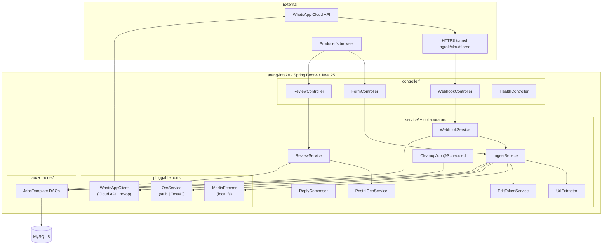
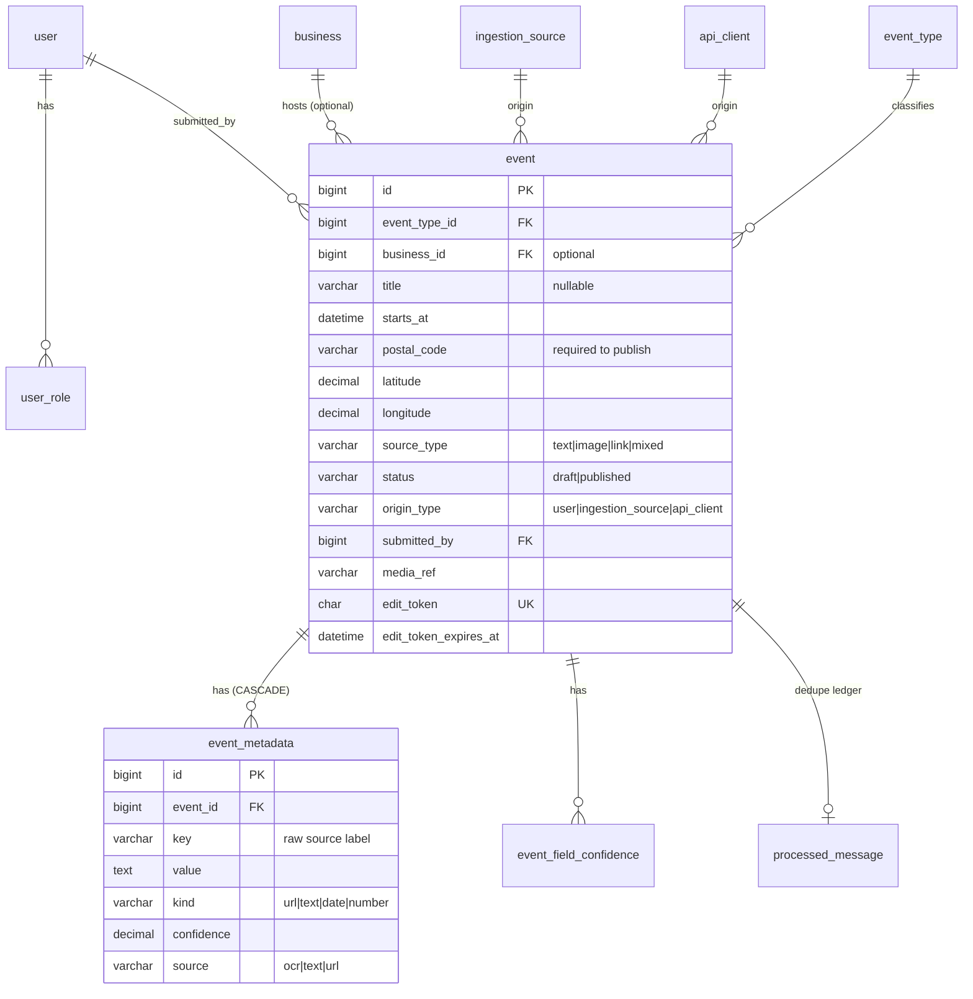
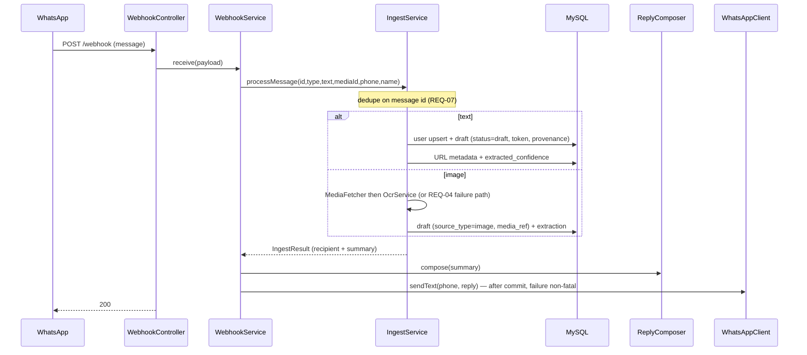
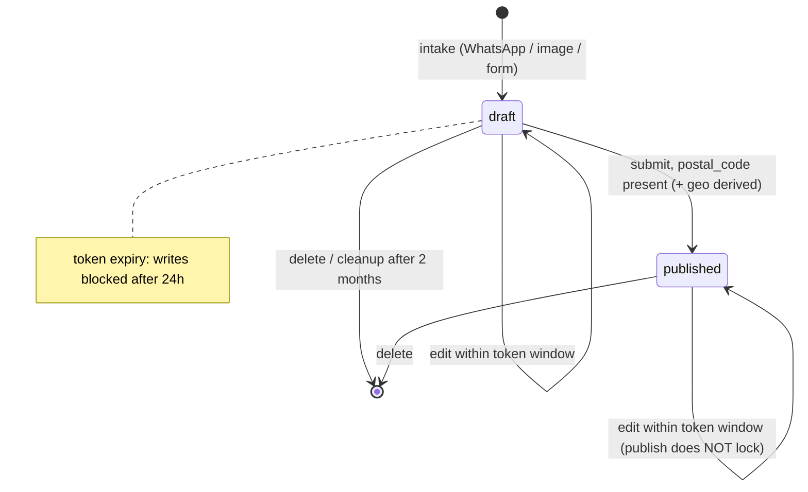

# Arang — Producer Intake (P1) — Software Design Document

> **Purpose.** A single, readable reference to the design of the Arang Producer-Intake service
> **as built**. It consolidates the spec-driven artifacts (PRD/TRD/SDD/TTP under
> `docs/p1-producer-intake/`) into one design narrative and reflects the actual implemented code.
>
> **Status:** P1 implemented (tasks T1–T9), full test suite green (42 tests). Running verified
> against MySQL 8 on Spring Boot 4.1.1 / Java 25.
> **Last updated:** 2026-10-22. **Owner:** (you).
>
> **Related (authoritative per stage):** `docs/p1-producer-intake/prd.md` (what & why),
> `trd.md` (REQ-01..18), `sdd.md` (incremental design history + DD log), `ttp.md` (TC-### plan),
> `.kiro/steering/design-philosophy.md` (generality rules).

---

## 1. Overview

Arang is a broad, long-lived **event platform**. P1 (“Producer Intake”) is the first slice: let a
producer get an event into Arang and correct it. A producer sends an event over **WhatsApp**
(text / image / link) or a **web form**; Arang extracts what it can, stores a **draft** with
provenance, replies with a private **review link**, and lets the producer review/edit/publish or
delete via a token-gated page. Abandoned drafts are cleaned up automatically.

**Core principle (from steering):** the *event* is the universal unit; **kind, origin, and role
are data, not schema**. The schema is a deliberate, long-lived artifact designed broad enough to
absorb future phases without migrating primary tables.

### 1.1 Scope (P1)
In: WhatsApp intake (text/image/link), minimal rule-based extraction (URLs), draft storage with
provenance + per-field confidence, confirmation reply with review link, token-authorized
review/edit/submit/delete, direct-entry web form, scheduled draft cleanup.
Out (later phases): consumer discovery (P2), multi-source ingestion connectors (P3), quantitative
NFRs / hardening (P4 — see `prd.md` OQ-P1-8).

## 2. Architecture

A single Spring Boot service (modular monolith) fronting MySQL. External edges — WhatsApp Cloud
API, OCR, postal-geo — sit behind interfaces so the app runs and is tested offline.



### 2.1 Technology stack (verified as-built)
| Concern | Choice |
|---|---|
| Language / runtime | **Java 25** (Temurin) |
| Framework | **Spring Boot 4.1.1** (Spring Framework 7, Jackson 3 `tools.jackson.*`) |
| Build | **Gradle 9.8.2** (wrapper) |
| Database | **MySQL 8**; schema via **Flyway** (`spring-boot-starter-flyway`) |
| Persistence | **Spring `JdbcTemplate`** (`NamedParameterJdbcTemplate`) DAOs with explicit SQL — no ORM. Flyway owns schema. |
| Web UI | Server-rendered **Thymeleaf** (review + form pages) |
| Tests | JUnit 5 + Spring Boot Test; **H2 (MySQL mode)** for the test datasource |

### 2.2 Module / package layout (`com.arang.intake`)
```
IntakeApplication            @SpringBootApplication @EnableScheduling @ConfigurationPropertiesScan
config/      WebhookProperties            (arang.whatsapp.* config)
controller/  WebhookController, ReviewController, FormController, HealthController
service/     WebhookService, IngestService (+ IngestResult), ReviewService,
             UrlExtractor, EditTokenService, PostalGeoService, CleanupJob
reply/       ReplyComposer, DraftSummary
whatsapp/    WhatsAppClient, CloudApiWhatsAppClient, WhatsAppClientConfig (+ no-op CapturingClient)
media/       MediaFetcher, LocalMediaFetcher
ocr/         OcrService, StubOcrService
model/       Event, EventMetadata, User, ProcessedMessage       (plain POJOs)
dao/         EventDao, EventMetadataDao, UserDao, ProcessedMessageDao  (JdbcTemplate, explicit SQL)
resources/   application.yml, application-test.yml, db/migration/V1__initial_schema.sql,
             templates/{review,form,deleted}.html
```

## 3. HTTP API (as-built)

| Method | Path | Auth | Purpose |
|---|---|---|---|
| GET | `/health` | none | Liveness JSON (also `/actuator/health`). |
| GET | `/webhook` | `hub.verify_token` | WhatsApp verification handshake → echoes `hub.challenge` (else 403). |
| POST | `/webhook` | (HMAC deferred, DD-6) | Inbound messages; records id, creates draft, 200 fast. |
| GET | `/review/{id}` | `?token=` | Render the prefilled review/edit page (else 404). |
| POST | `/review/{id}` | `?token=` | Save field edits. |
| POST | `/review/{id}/submit` | `?token=` | Publish (requires postal code; derives geo). |
| POST | `/review/{id}/delete` | `?token=` | Delete the event + metadata. |
| GET | `/submit` | none (network-restricted) | Direct-entry web form. |
| POST | `/submit` | none | Create a draft; redirect to the review page. |

> There is **no Swagger/OpenAPI UI**: `springdoc-openapi` has no Spring Boot 4–compatible release
> yet (latest 2.8.x targets Boot 3). Revisit when springdoc ships Boot 4 support.

## 4. Data model

The **full 21-table schema** is created up front (one Flyway migration `V1`) so later phases add
rows and code, never a primary-table migration. P1 *uses* a subset; the rest is structure-ahead.
Full DDL: `src/main/resources/db/migration/V1__initial_schema.sql` (mirrored in `sdd.md §1`).



Table groups: **identity** (`user`, `user_role`, `user_metadata`), **business**
(`business`, `business_metadata`), **provenance** (`ingestion_source`,
`ingestion_source_metadata`, `api_client`), **event core** (`event_type`, `event`,
`event_metadata`, `event_field_confidence`), **discovery [P2]** (`category`, `tag`,
`event_category`, `event_tag`, `interest`), **feedback [P2]** (`feedback`), **conversation [P2]**
(`conversation`, `message`), **idempotency** (`processed_message`).

Key modeling rules (steering): `user` is identity-only (roles live in `user_role`); an event's
**origin** is `origin_type` + one of three nullable FKs; event **attributes** that aren't typed
core go to `event_metadata` (lossless, interpret-later); `signal` in `feedback` is backtick-quoted
(MySQL reserved word — a bug H2 masked and real MySQL surfaced).

## 5. Key flows

### 5.1 WhatsApp intake → draft → reply


### 5.2 Event lifecycle (token-gated)


## 6. Design decisions (resolved)
| ID | Decision |
|---|---|
| DD-1 | Typed-core confidence → dedicated `event_field_confidence` table. |
| DD-2 | Author the **full schema up front** (no per-phase primary-table migrations). |
| DD-3 | Postal geo → bundled US ZIP-centroid lookup; unknown ZIP still publishes (null lat/long). |
| DD-4 | Review page → **Thymeleaf** server-rendered. |
| DD-5 | Media storage → **local filesystem** `media_ref` (behind `MediaFetcher`). |
| DD-6 | Webhook HMAC signature verification **deferred to P4**; GET verify-token + network restriction for now. |
| OQ-P1-6 | Per-field source (`ocr|text|url`) captured as `event_metadata.source`. |

## 7. External integration points (pluggable, offline by default)
| Port | Default (offline) | Real impl / activation |
|---|---|---|
| `WhatsAppClient` | no-op capturing client | `CloudApiWhatsAppClient` when `arang.whatsapp.access-token` set |
| `MediaFetcher` | returns empty when no token (→ REQ-04 path) | Graph media download → local fs |
| `OcrService` | `StubOcrService` (empty text) | drop-in Tess4J / cloud OCR bean |
| `EventExtractor` | `RuleBasedEventExtractor` (no NLU) | `LlmEventExtractor` (Ollama) or `GeminiEventExtractor`, when `arang.llm.enabled=true` |

### 7.1 LLM event extraction (normalize → classify → extract)
Beyond URL regex, a message (and any OCR'd image text, aggregated) can be deciphered into the
standardized event by an LLM, run **async + best-effort** so intake never blocks and a failure
never loses a draft (`EventEnrichmentService.enrichAsync`). The LLM both **classifies**
(garbage/non-event → flagged, fields left empty) and **extracts** (title/start/location/type +
per-field confidence) via one prompt (`ExtractionJsonParser`, shared across providers).

- **Provider selection** (`EventExtractorConfig`): `arang.llm.enabled` + `arang.llm.provider`
  (`ollama` local OpenAI-compatible, or `gemini` REST `generateContent`). Disabled by default.
- **Daily cap** (`DailyRequestLimiter`, default **70/day**, resets at local midnight): a hard,
  shared limit protecting trial quotas (e.g. a Gemini free key). When exhausted, extraction is
  skipped — the draft still exists and is editable. In-memory (resets on restart); a DB-backed
  counter is the hardening step for restart-proof / multi-instance limits.
- The console polls `/api/producer/message/{id}/status` and surfaces the deciphered fields (or a
  "not an event" note) once enrichment lands.

## 8. Configuration
`arang.whatsapp.*` (env-bound): `verify-token`, `access-token`, `phone-number-id`,
`public-base-url` (tunnel URL for review links), `low-confidence-threshold` (default 0.5).
`ARANG_DB_URL|USER|PASSWORD` for the datasource. Schema is Flyway-managed; persistence is
`JdbcTemplate`-based (no JPA/Hibernate — no `ddl-auto`).

## 9. Security & provenance (P1 posture)
- **Object-level capability:** the per-event `edit_token` (43-char URL-safe, 24h expiry)
  authorizes review/edit/submit/delete on exactly one event — not user authentication.
- **No user authn/authz in P1** (deferred, platform-wide); privileged surfaces rely on network
  restriction. HMAC webhook signing deferred (DD-6). Quantitative security hardening → P4.
- Every event records origin (`origin_type` + reference) and timestamps (REQ-15).

## 10. Testing
43 `@Test` methods across 10 classes (42 reported runs) — all green. Coverage: webhook verify +
idempotency, text/image ingest + extraction + confidence + provenance, reply composition + send
wiring, token-gated review/edit, submit/publish/geo/delete, web form, scheduled cleanup. Tests use
H2 (MySQL mode). Full plan + REQ↔TC map: `docs/p1-producer-intake/ttp.md`.

**Known gap:** tests run on H2, not real MySQL — which let the `signal` reserved-word bug through
until a live-MySQL boot. Recommended follow-up: add Testcontainers-MySQL for the schema/repository
tests.

## 11. How to run
```bash
export JAVA_HOME="$HOME/Library/Java/JavaVirtualMachines/temurin-25/Contents/Home"
# MySQL on :3306 with db=arang user=arang pass=arang (or override ARANG_DB_* )
./gradlew bootJar
ARANG_WHATSAPP_VERIFY_TOKEN=demo-token java -jar build/libs/intake-0.0.1-SNAPSHOT.jar
# → http://localhost:8080  (try /health, /submit, POST /webhook)
```

## 12. Traceability & requirements
Chain: `UF → AC (prd.md) → REQ-01..18 (trd.md) → T1..T9 (tasks) → TC-### (ttp.md)`. All 18 REQs
are implemented. REQ-16 (persistence) is covered by Flyway + repository round-trips rather than a
dedicated restart test; REQ-08's low-confidence-flag mechanism exists but P1's minimal extraction
rarely triggers it (typed-core stays null until a later LLM pass).

## 13. Version history
- **2026-10-22 (b):** Persistence migrated from Spring Data JPA/Hibernate to **`JdbcTemplate`
  DAOs with explicit SQL** (`dao/` package; models are now plain POJOs). Behavior-equivalent —
  full suite (42 tests) green and verified end-to-end against real MySQL. Flyway unchanged.
- **2026-10-22 (a):** Initial consolidated SDD, as-built after P1 (T1–T9).
