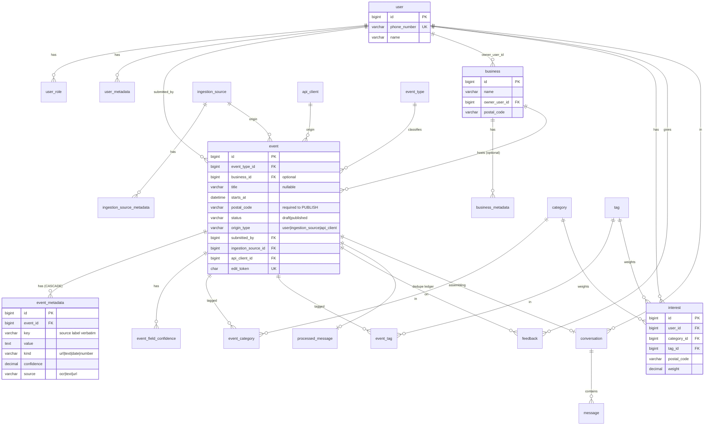
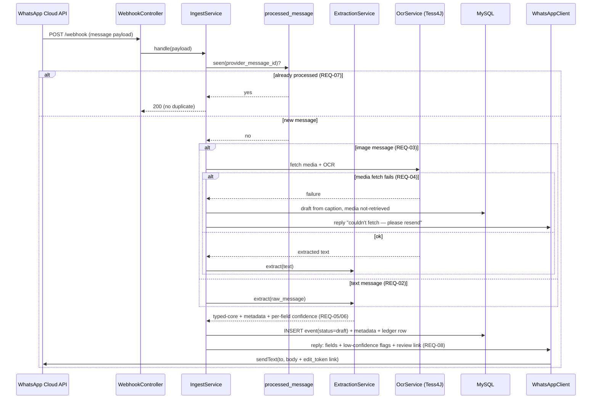
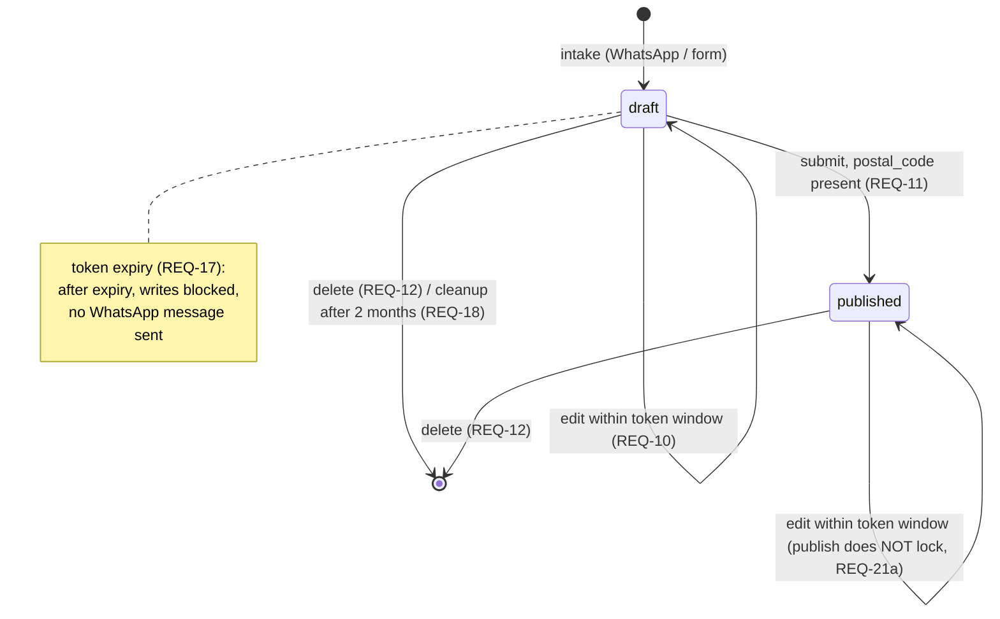
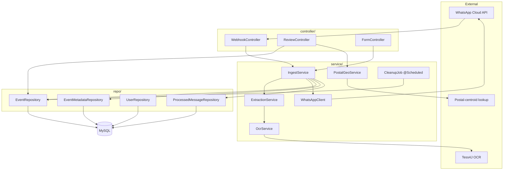

# Arang — Producer Intake (P1) — SDD

> *How* P1 is built. Realizes the requirements in `docs/p1-producer-intake/trd.md` (REQ-01..18),
> which in turn trace to the approved PRD v1.0. Covers **P1 only**; the schema is designed broad
> (per the generality steering) but this doc only **creates** what P1 needs. No application code
> is written until this design is approved.
>
> Traceability chain: `UF → AC (PRD) → REQ (TRD) → T# (§6 here) → TC (TTP)`.

---

## 1. Data model (MySQL — FULL schema, authored once)

> Engine **MySQL 8**. Per the generality steering, **the schema is the deliberate, long-lived
> artifact** — so the *entire* model is created up front (one Flyway migration `V1`), **not** a
> P1 subset that would force later migrations to primary tables. Tables are grouped by concern
> and tagged **[P1]** (used now) / **[P2]** / **[P3]** (structure now, populated when that phase
> lands). Three storage strategies: typed core on primary entities · per-entity key/value
> metadata (the escape hatch) · lookup/join tables for shared vocabulary.
>
> This resolves **DD-2** (full schema up front), **DD-1** (`event_field_confidence` table), and
> **OQ-P1-6** (`event_metadata.source`). The authoritative copy lives in the Flyway migration
> `src/main/resources/db/migration/V1__initial_schema.sql`; this section mirrors it.

**Entities (21 tables) by concern:**

| Concern | Tables | Phase |
|---|---|---|
| Identity & role | `user`, `user_role`, `user_metadata` | [P1] (metadata later) |
| Business | `business`, `business_metadata` | structure now; linked from `event` |
| Provenance / origin | `ingestion_source`, `ingestion_source_metadata`, `api_client` | [P3] (P1 uses `user` origin) |
| Event core | `event_type`, `event`, `event_metadata`, `event_field_confidence` | [P1] |
| Discovery vocabulary | `category`, `tag`, `event_category`, `event_tag`, `interest` | [P2] |
| Feedback | `feedback` | [P2] |
| Conversation trail | `conversation`, `message` | [P2] |
| Idempotency | `processed_message` | [P1] |

**Origin model:** `event.origin_type` ∈ (`user` \| `ingestion_source` \| `api_client`), each with
its own nullable FK (`submitted_by`, `ingestion_source_id`, `api_client_id`). Only `user`-origin
events hold an `edit_token`. **Required-vs-optional (D5):** most columns are nullable
("store-with-gap-flagged"); publish-time constraints (e.g. `postal_code` present) are enforced in
app logic, not as `NOT NULL`.

```sql
-- ---------- IDENTITY & ROLE [P1] --------------------------------------
CREATE TABLE `user` (                               -- identity ONLY (no user_type column)
  id BIGINT PRIMARY KEY AUTO_INCREMENT,
  phone_number VARCHAR(32) UNIQUE,                  -- WhatsApp id; null for form-only
  name VARCHAR(255),
  created_at TIMESTAMP DEFAULT CURRENT_TIMESTAMP,
  updated_at TIMESTAMP DEFAULT CURRENT_TIMESTAMP ON UPDATE CURRENT_TIMESTAMP
);
CREATE TABLE user_role (                            -- role is DATA: producer AND consumer, etc.
  id BIGINT PRIMARY KEY AUTO_INCREMENT,
  user_id BIGINT NOT NULL,
  role VARCHAR(32) NOT NULL,                        -- producer|consumer|operator|business_owner|api_client|moderator
  created_at TIMESTAMP DEFAULT CURRENT_TIMESTAMP,
  UNIQUE (user_id, role),
  FOREIGN KEY (user_id) REFERENCES `user`(id) ON DELETE CASCADE
);
CREATE TABLE user_metadata (                        -- escape-hatch extras for users
  id BIGINT PRIMARY KEY AUTO_INCREMENT,
  user_id BIGINT NOT NULL,
  `key` VARCHAR(100) NOT NULL, `value` TEXT, kind VARCHAR(16), confidence DECIMAL(3,2),
  created_at TIMESTAMP DEFAULT CURRENT_TIMESTAMP,
  FOREIGN KEY (user_id) REFERENCES `user`(id) ON DELETE CASCADE
);

-- ---------- BUSINESS (primary entity) ---------------------------------
CREATE TABLE business (                             -- venue / shop / organizer
  id BIGINT PRIMARY KEY AUTO_INCREMENT,
  name VARCHAR(255) NOT NULL,
  owner_user_id BIGINT,                             -- optional owning user (business_owner role)
  location VARCHAR(255), postal_code VARCHAR(16), country_code CHAR(2) DEFAULT 'US',
  latitude DECIMAL(9,6), longitude DECIMAL(9,6),
  created_at TIMESTAMP DEFAULT CURRENT_TIMESTAMP,
  updated_at TIMESTAMP DEFAULT CURRENT_TIMESTAMP ON UPDATE CURRENT_TIMESTAMP,
  FOREIGN KEY (owner_user_id) REFERENCES `user`(id)
);
CREATE TABLE business_metadata (
  id BIGINT PRIMARY KEY AUTO_INCREMENT,
  business_id BIGINT NOT NULL,
  `key` VARCHAR(100) NOT NULL, `value` TEXT, kind VARCHAR(16), confidence DECIMAL(3,2),
  created_at TIMESTAMP DEFAULT CURRENT_TIMESTAMP,
  FOREIGN KEY (business_id) REFERENCES business(id) ON DELETE CASCADE
);

-- ---------- PROVENANCE / ORIGIN [P3] ----------------------------------
CREATE TABLE ingestion_source (                     -- a configured source a connector reads
  id BIGINT PRIMARY KEY AUTO_INCREMENT,
  name VARCHAR(255) NOT NULL,
  connector_shape VARCHAR(32) NOT NULL,             -- push_api|pull_api|structured_web|unstructured_web|document|image|messaging_social
  location VARCHAR(255), url_or_reference VARCHAR(512),
  enabled BOOLEAN NOT NULL DEFAULT TRUE, last_run_at DATETIME,
  created_at TIMESTAMP DEFAULT CURRENT_TIMESTAMP,
  updated_at TIMESTAMP DEFAULT CURRENT_TIMESTAMP ON UPDATE CURRENT_TIMESTAMP
);
CREATE TABLE ingestion_source_metadata (
  id BIGINT PRIMARY KEY AUTO_INCREMENT,
  ingestion_source_id BIGINT NOT NULL,
  `key` VARCHAR(100) NOT NULL, `value` TEXT, kind VARCHAR(16),
  created_at TIMESTAMP DEFAULT CURRENT_TIMESTAMP,
  FOREIGN KEY (ingestion_source_id) REFERENCES ingestion_source(id) ON DELETE CASCADE
);
CREATE TABLE api_client (                           -- inbound Push-API caller
  id BIGINT PRIMARY KEY AUTO_INCREMENT,
  name VARCHAR(255) NOT NULL,
  api_key_hash VARCHAR(128),                        -- store a hash, never the raw key
  enabled BOOLEAN NOT NULL DEFAULT TRUE,
  created_at TIMESTAMP DEFAULT CURRENT_TIMESTAMP
);

-- ---------- EVENT (the universal unit) [P1] ---------------------------
CREATE TABLE event_type (                           -- kind is DATA, not schema
  id BIGINT PRIMARY KEY AUTO_INCREMENT,
  name VARCHAR(50) NOT NULL UNIQUE,                 -- concert|offer|workshop|festival|class...
  description VARCHAR(255)
);
CREATE TABLE event (
  id BIGINT PRIMARY KEY AUTO_INCREMENT,
  event_type_id BIGINT,                             -- nullable: classify later
  business_id BIGINT,                               -- optional type-driven link (offer→business)
  title VARCHAR(255), starts_at DATETIME, ends_at DATETIME,  -- ends_at also = offer validity window
  location VARCHAR(255),
  postal_code VARCHAR(16), country_code CHAR(2) NOT NULL DEFAULT 'US',
  latitude DECIMAL(9,6), longitude DECIMAL(9,6),    -- derived from postal centroid
  source_type VARCHAR(16) NOT NULL,                 -- text|image|link|mixed
  raw_message TEXT, media_ref VARCHAR(512),
  extracted_confidence DECIMAL(3,2),                -- derived roll-up (min)
  status VARCHAR(16) NOT NULL DEFAULT 'draft',      -- draft|published
  origin_type VARCHAR(16) NOT NULL,                 -- user|ingestion_source|api_client
  submitted_by BIGINT, ingestion_source_id BIGINT, api_client_id BIGINT,  -- one per origin_type
  edit_token CHAR(43) UNIQUE, edit_token_expires_at DATETIME,   -- user-origin only; +24h
  created_at TIMESTAMP DEFAULT CURRENT_TIMESTAMP,
  updated_at TIMESTAMP DEFAULT CURRENT_TIMESTAMP ON UPDATE CURRENT_TIMESTAMP,
  FOREIGN KEY (event_type_id) REFERENCES event_type(id),
  FOREIGN KEY (business_id) REFERENCES business(id),
  FOREIGN KEY (submitted_by) REFERENCES `user`(id),
  FOREIGN KEY (ingestion_source_id) REFERENCES ingestion_source(id),
  FOREIGN KEY (api_client_id) REFERENCES api_client(id)
);
CREATE INDEX idx_event_status ON event(status);
CREATE INDEX idx_event_starts_at ON event(starts_at);
CREATE INDEX idx_event_postal ON event(postal_code, country_code);
CREATE INDEX idx_event_edit_token ON event(edit_token);
CREATE INDEX idx_event_business ON event(business_id);
CREATE INDEX idx_event_type ON event(event_type_id);
CREATE INDEX idx_event_origin ON event(origin_type);

CREATE TABLE event_metadata (                       -- labeled, lossless, interpret-later
  id BIGINT PRIMARY KEY AUTO_INCREMENT,
  event_id BIGINT NOT NULL,
  `key` VARCHAR(100) NOT NULL,                      -- raw source label ("Tickets","RSVP","Price")
  `value` TEXT, kind VARCHAR(16),                   -- url|text|date|number
  confidence DECIMAL(3,2),
  source VARCHAR(16),                               -- ocr|text|url  (per-field provenance; resolves OQ-P1-6)
  created_at TIMESTAMP DEFAULT CURRENT_TIMESTAMP,
  FOREIGN KEY (event_id) REFERENCES event(id) ON DELETE CASCADE
);
CREATE INDEX idx_evmeta_event ON event_metadata(event_id);
CREATE INDEX idx_evmeta_key ON event_metadata(`key`);

CREATE TABLE event_field_confidence (               -- DD-1 (a): typed-core confidence, no bloat
  id BIGINT PRIMARY KEY AUTO_INCREMENT,
  event_id BIGINT NOT NULL,
  field VARCHAR(50) NOT NULL,                       -- title|starts_at|location|postal_code...
  confidence DECIMAL(3,2),
  UNIQUE (event_id, field),
  FOREIGN KEY (event_id) REFERENCES event(id) ON DELETE CASCADE
);

-- ---------- DISCOVERY VOCABULARY [P2] ---------------------------------
CREATE TABLE category (id BIGINT PRIMARY KEY AUTO_INCREMENT, name VARCHAR(80) NOT NULL UNIQUE, description VARCHAR(255));
CREATE TABLE tag (id BIGINT PRIMARY KEY AUTO_INCREMENT, name VARCHAR(80) NOT NULL UNIQUE);
CREATE TABLE event_category (
  event_id BIGINT NOT NULL, category_id BIGINT NOT NULL,
  PRIMARY KEY (event_id, category_id),
  FOREIGN KEY (event_id) REFERENCES event(id) ON DELETE CASCADE,
  FOREIGN KEY (category_id) REFERENCES category(id) ON DELETE CASCADE
);
CREATE TABLE event_tag (
  event_id BIGINT NOT NULL, tag_id BIGINT NOT NULL,
  PRIMARY KEY (event_id, tag_id),
  FOREIGN KEY (event_id) REFERENCES event(id) ON DELETE CASCADE,
  FOREIGN KEY (tag_id) REFERENCES tag(id) ON DELETE CASCADE
);
CREATE TABLE interest (                             -- consumer interests (category/tag/location, weighted)
  id BIGINT PRIMARY KEY AUTO_INCREMENT,
  user_id BIGINT NOT NULL, category_id BIGINT, tag_id BIGINT, postal_code VARCHAR(16),
  weight DECIMAL(4,3) DEFAULT 1.000,
  created_at TIMESTAMP DEFAULT CURRENT_TIMESTAMP,
  FOREIGN KEY (user_id) REFERENCES `user`(id) ON DELETE CASCADE,
  FOREIGN KEY (category_id) REFERENCES category(id),
  FOREIGN KEY (tag_id) REFERENCES tag(id)
);

-- ---------- FEEDBACK [P2] ---------------------------------------------
CREATE TABLE feedback (
  id BIGINT PRIMARY KEY AUTO_INCREMENT,
  user_id BIGINT, event_id BIGINT,
  `signal` VARCHAR(32) NOT NULL,                    -- like|dismiss|save|attend (reserved word → quoted)...
  created_at TIMESTAMP DEFAULT CURRENT_TIMESTAMP,
  FOREIGN KEY (user_id) REFERENCES `user`(id) ON DELETE SET NULL,
  FOREIGN KEY (event_id) REFERENCES event(id) ON DELETE CASCADE
);

-- ---------- CONVERSATION / MESSAGE TRAIL [P2] -------------------------
CREATE TABLE conversation (
  id BIGINT PRIMARY KEY AUTO_INCREMENT,
  user_id BIGINT, event_id BIGINT,                  -- pending event being assembled, if any
  state VARCHAR(32),                                -- awaiting_field|complete...
  created_at TIMESTAMP DEFAULT CURRENT_TIMESTAMP,
  updated_at TIMESTAMP DEFAULT CURRENT_TIMESTAMP ON UPDATE CURRENT_TIMESTAMP,
  FOREIGN KEY (user_id) REFERENCES `user`(id),
  FOREIGN KEY (event_id) REFERENCES event(id) ON DELETE SET NULL
);
CREATE TABLE message (
  id BIGINT PRIMARY KEY AUTO_INCREMENT,
  conversation_id BIGINT,
  direction VARCHAR(8) NOT NULL,                    -- inbound|outbound
  body TEXT, provider_message_id VARCHAR(128),
  created_at TIMESTAMP DEFAULT CURRENT_TIMESTAMP,
  FOREIGN KEY (conversation_id) REFERENCES conversation(id) ON DELETE CASCADE
);

-- ---------- IDEMPOTENCY [P1] ------------------------------------------
CREATE TABLE processed_message (                    -- WhatsApp redelivery dedupe (REQ-07)
  provider_message_id VARCHAR(128) PRIMARY KEY,
  event_id BIGINT,
  processed_at TIMESTAMP DEFAULT CURRENT_TIMESTAMP
);
```

**P1 touches** only `user`, `user_role`, `event_type`, `event`, `event_metadata`,
`event_field_confidence`, and `processed_message`; the rest are created now so P2/P3 add **rows
and code, never a primary-table migration**.

---

## 2. Behavior → implementation (how each flow is realized)

- **Webhook (REQ-01/02/03/07):** `WebhookController` → `GET` verify-token check; `POST` →
  `IngestService.handle(payload)`: dedupe via `processed_message`, branch on message type,
  call `ExtractionService`, persist, enqueue reply.
- **OCR (REQ-03):** `OcrService` wraps Tess4J; image fetched from the Cloud API media endpoint
  to local storage (`media_ref`). OCR failure → confidence low, not reject (V2/V2b).
- **Extraction (REQ-05/06):** `ExtractionService` parses text/OCR output into typed-core
  candidates + labeled metadata, each with a confidence; rule/regex for P1 (LLM swap later).
- **Reply (REQ-08):** `WhatsAppClient.sendText(to, body)` with the review link; built within
  the 24h window.
- **Review page (REQ-09/10/11/12):** `ReviewController` (server-rendered Thymeleaf or minimal
  JSON+static) → `token` validated against `event.edit_token` + `edit_token_expires_at`;
  GET renders, POST saves/submits/deletes.
- **Geo (REQ-13):** `PostalGeoService` maps (postal_code,country) → centroid lat/long via a
  bundled lookup table (US ZIP centroids for the prototype; DD-3 on data source).
- **Form (REQ-14):** `FormController` reuses `IngestService` with `origin_type=user`, no phone.
- **Cleanup (REQ-18):** `@Scheduled` job deletes `status='draft' AND created_at < now-2mo`.

---

## 3. Module / package structure (`com.arang.intake`)
```
config/        WhatsAppConfig, AppConfig
controller/    WebhookController, ReviewController, FormController
service/       IngestService, ExtractionService, OcrService, PostalGeoService,
               WhatsAppClient, CleanupJob
repo/          EventRepository, EventMetadataRepository, UserRepository,
               ProcessedMessageRepository
model/         Event, EventMetadata, User, EventType  (+ enums)
```
Build: Gradle; Spring Boot (web, jdbc, validation, scheduling); Tess4J; MySQL driver.

---

## 4. Diagrams

> Mermaid (renders on GitHub / most editors; diff-able plain text). Each pictures a shape the
> text above otherwise makes the reader assemble by hand; nodes reference the REQs they realize.
> Kept in sync with the schema (§1), behavior (§2), and module layout (§3).

### 4.1 ER diagram — the full schema (§1)



> Lookup/metadata/idempotency tables (`user_role`, `user_metadata`, `business_metadata`,
> `ingestion_source(_metadata)`, `api_client`, `event_type`, `category`, `tag`,
> `event_field_confidence`, `conversation`, `message`, `processed_message`) are shown by their
> relationships; full columns are in the §1 DDL.

### 4.2 Sequence — WhatsApp intake (REQ-01/02/03/04/05/06/07/08)



### 4.3 State — event lifecycle + token/cleanup (REQ-11/12/17/18/21a)



### 4.4 Component — `com.arang.intake` (§3) + external edges



---

## 5. Checks (how each REQ is proven — feeds the TTP)
- REQ-01/07/13/18 → integration tests (webhook verify, dedupe, geo-derivation, cleanup).
- REQ-02..06/08 → service tests with sample text + a sample flyer image fixture.
- REQ-09..12 → controller tests for token valid/invalid/expired, edit, submit (postal gate),
  delete.
- REQ-16 → restart test / repo persistence test.
- Manual: end-to-end over a tunnel with the WhatsApp test number (1 text, 1 flyer).

---

## 6. Dependency-ordered tasks (D5 — slice plan)
> Cap 5–12; each ≈ 1 concern / ≤3 files / 1 test run. Ordered so each builds on the last.
- **T1** — Project skeleton: Gradle Spring Boot app, MySQL config, Flyway/DDL for the schema (§1), health check. *(REQ-16)*
- **T2** — Webhook verify + receive + idempotency ledger. *(REQ-01, REQ-07)*
- **T3** — Text intake → extraction (rule-based) → persist draft + per-field confidence. *(REQ-02, REQ-05, REQ-06, REQ-15)*
- **T4** — WhatsApp reply with review link (+ low-confidence flags). *(REQ-08)*
- **T5** — Review page: token-gated GET/edit/save. *(REQ-09, REQ-10)*
- **T6** — Submit (postal-required + geo-derive) + publish; delete. *(REQ-11, REQ-12, REQ-13)*
- **T7** — Image intake: media fetch + Tess4J OCR + failure path. *(REQ-03, REQ-04)*
- **T8** — Direct-entry web form. *(REQ-14)* `[stretch]`
- **T9** — Scheduled draft-cleanup job. *(REQ-18)*
- **Slice 1 = T1→T4** (a running app: text in → stored draft → WhatsApp reply with link).

---

## 7. Design decisions
- **DD-1 — typed-core confidence storage: RESOLVED (2026-10-21).** A dedicated
  `event_field_confidence(event_id, field, confidence)` table (option a) — clean, queryable, no
  core-table bloat. Created in §1 / `V1`.
- **DD-2 — subset vs. full schema: RESOLVED (2026-10-21).** Author the **full schema up front**
  (all 21 tables), per the generality steering ("schema is the deliberate, long-lived artifact").
  This replaces the earlier "future columns unused in P1" hedge — `business`, the three origin
  FKs, discovery/feedback/conversation entities, etc. are all created now so P2/P3 add rows and
  code, never a primary-table migration.
- **OQ-P1-6 — per-field source (ocr/text/url): RESOLVED.** Added as `event_metadata.source` in
  the full schema (no longer deferred). The PRD OQ-P1-6 "deferred" note is now superseded here.
- **DD-3 — postal-centroid data source: RESOLVED (2026-10-22).** Small bundled US ZIP-centroid
  lookup for the prototype; unknown ZIP → publish still succeeds with null lat/long (approximate,
  best-effort). International deferred.
- **DD-4 — review page tech: RESOLVED (2026-10-22).** Server-rendered **Thymeleaf** (one app, no
  separate frontend).
- **DD-5 — media storage: RESOLVED (2026-10-22).** Local filesystem path in `media_ref` (behind a
  `MediaFetcher` interface; a real Graph media download / object store is a drop-in replacement).
- **DD-6 — webhook payload signature (HMAC): DEFERRED → P4 (2026-10-21).** T2 implements the GET
  `hub.verify_token` handshake (REQ-01) but accepts POSTs without verifying Meta's
  `X-Hub-Signature-256` HMAC. Full payload-signature verification is a hardening item deferred to
  the Hardening/NFR phase (P4, OQ-P1-8). Until then the webhook relies on the verify-token
  handshake + network restriction.
- **Edge note (T2 idempotency ledger):** `processed_message` rows are written on first receipt
  with `event_id = NULL` (before any event exists). If later event creation (T3) fails, a ledger
  row can persist with no linked event. This is acceptable: a redelivery is still correctly
  treated as already-seen (REQ-07 holds); the orphan is harmless. Revisit if T3 needs
  retry-on-failure semantics.

## 8. Version history
- **v1.5 (2026-10-22):** **T5–T9 implemented** (all remaining P1 tasks). T5 token-gated review/
  edit page (Thymeleaf, DD-4 resolved); T6 submit/publish + ZIP-centroid geo (DD-3 resolved) +
  delete; T7 image intake with media fetch + OCR + REQ-04 failure path (OCR/media behind
  interfaces, stub defaults, DD-5 local-fs resolved); T8 direct-entry web form; T9 scheduled
  draft cleanup. Design decisions DD-3/DD-4/DD-5 resolved with the recommended defaults (recorded
  as approved assumptions under autonomous execution). **Verified: full suite 42 tests, 0
  failures.** Coverage note: REQ-16 (persistence) is exercised via Flyway + repository round-trip,
  not a dedicated restart test; REQ-08's low-confidence-flag mechanism exists but P1 extraction
  rarely triggers it (typed-core stays null until the LLM phase).
- **v1.4 (2026-10-21):** **T4 implemented** (WhatsApp reply with review link + low-confidence
  flags — REQ-08, AC-005, AC-006). Added `WhatsAppClient` interface + `CloudApiWhatsAppClient`
  (Cloud API) + a no-op capturing client, selected by a factory on whether an access token is
  configured (offline-testable); `ReplyComposer` (pure reply-text builder); send-after-commit
  wiring (`ingestText` returns `IngestResult`; reply sent outside the draft transaction; failed
  send logged, not fatal). Config: `access-token`, `phone-number-id`, `public-base-url`,
  `low-confidence-threshold`. Note: `@ConditionalOnProperty` treats an empty-string token as
  present, so client selection uses an explicit factory instead. Verified: 22 tests pass. No
  spec/schema change.
- **v1.3 (2026-10-21):** **T3 implemented** (text intake → rule-based URL extraction → persist
  draft + per-field confidence + provenance — REQ-02/05/06/15). Added `User`/`Event`/`EventMetadata`
  entities + repositories, `UrlExtractor`, `EditTokenService` (43-char URL-safe token, 24h expiry),
  and `IngestService.ingestText`; wired `WebhookService` to ingest text and link the ledger
  `event_id` (image/other still stubbed for T7). Per the recorded decisions: minimal honest
  extraction (URLs only, typed-core left null), `extracted_confidence` = min of extracted (1.00 for
  URLs, null when nothing extracted), get-or-create user by phone, `source_type='text'`, token at
  creation. Verified: 14 tests pass. No spec/schema change.
- **v1.2 (2026-10-21):** **T2 implemented** (webhook verify + receive + idempotency ledger —
  REQ-01, REQ-07). Added DD-6 (HMAC payload-signature verification deferred to P4) and the
  ledger-orphan edge note. Build gotchas recorded for later tasks: Spring Boot 4 ships **Jackson 3**
  (`tools.jackson.databind.*`) and splits **Flyway autoconfig** into `spring-boot-starter-flyway`
  (raw `flyway-core` does not trigger it). Verified: 7 tests pass, Flyway applies V1.
- **v1.1 (2026-10-21):** **Replaced the P1-subset schema with the full long-lived schema** (21
  tables) per the generality steering — resolves DD-2 (full up front), DD-1 (`event_field_confidence`
  table), and OQ-P1-6 (`event_metadata.source`). Added: `business`/`business_metadata`,
  `user_metadata`, generalized provenance (`ingestion_source`/`ingestion_source_metadata`/
  `api_client` + three origin FKs on `event`), discovery vocabulary (`category`/`tag`/
  `event_category`/`event_tag`/`interest`), `feedback`, and `conversation`/`message`. Updated §1
  DDL and the §4.1 ER diagram. **Verified:** the full `V1` migration applies against H2 and the
  app boots (`./gradlew test` BUILD SUCCESSFUL, 2/0/0). P1 still *implements* only its subset of
  tables; the rest are structure-ahead.
- **v1.0 (2026-10-20):** Split out from the former folded `design.md` (SDD v0.2). The TRD
  (REQ-01..18) now lives in `docs/p1-producer-intake/trd.md`; this doc references it rather than
  restating it. Schema, behavior→impl, module structure, diagrams (ER/sequence/state/component),
  checks, 9 tasks (slice 1 = T1–T4), and DD-1..5 are unchanged in substance; section numbers
  shifted up by one (former §2→§1 … §9→§8) now that the folded TRD is removed. No code written.
- *(History before the split is recorded in the retired `design.md`: v0.1 2026-10-14 initial SDD;
  v0.2 2026-10-20 added diagrams.)*
