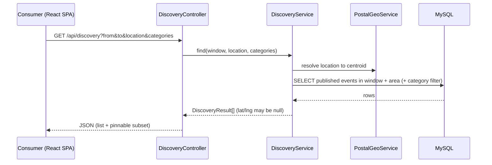
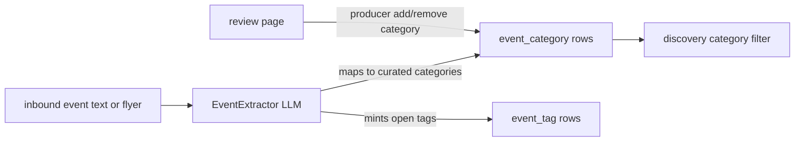
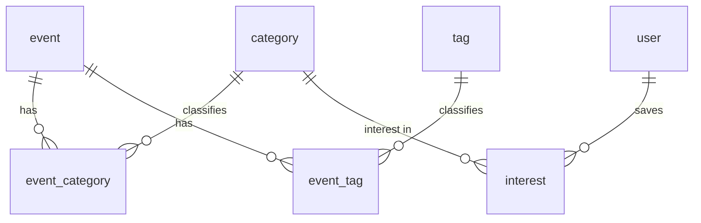

# Arang — Consumer Discovery (P2) — SDD

> *How* P2 is built. Realizes the core requirements in `docs/p2-consumer-discovery/trd.md`
> (REQ-01..19), which trace to the approved PRD. P2 **reads** the published events P1 already
> produces, adds a consumer discovery surface (React SPA + JSON API), and **owns** the event-
> categorization extension of the existing LLM enrichment. The SPA is **built into the Spring Boot
> app and served same-origin** (DD-P2-6), so there is no cross-origin API call. Stretch REQ-S1
> (WhatsApp "what's on?" reply) and REQ-S2 (calendar view) are **explicitly out of scope for this
> SDD** and are deferred. No application code is written until this design is approved.
>
> Traceability chain: `UF → AC (PRD) → REQ (TRD) → T# (§6 here) → TC (TTP)`.

## 1. Data model (MySQL — reuses the P1 full schema; P2 adds seed data, not primary tables)

> Per the generality steering, the schema was authored in full at P1. P2 introduces **no new
> primary table** — it populates and reads tables that already exist: `event`, `event_category`,
> `event_tag`, `category`, `tag`, `interest`, `user`. The only DDL-level change is a new Flyway
> migration that **seeds the curated category vocabulary** and adds indexes discovery needs. Web
> consumer identity reuses the `user` table (a lightweight row keyed by a cookie id).

Tables P2 uses (all created in P1 `V1`):
| Table | P2 use |
|---|---|
| `event` | read: published events, `starts_at`, `postal_code`, `latitude`/`longitude`, `business_id` |
| `category` | the curated spine (seeded by P2); drives filters + interest capture |
| `tag` | open long tail; LLM-minted during enrichment |
| `event_category` | join: which curated categories an event has (written at enrichment + review) |
| `event_tag` | join: open tags on an event (written at enrichment) |
| `interest` | consumer's saved interests `(user_id, category_id|tag_id, postal_code, weight)` |
| `user` | consumer identity row (WhatsApp phone, or web cookie id) |

```sql
-- V2 migration (P2): seed the curated category vocabulary + discovery indexes.
-- 15 categories is the deliberate MVP count (PRD/TRD allow ~15-25, fixed for MVP; OQ-P2-6), not a placeholder.
INSERT INTO category (name, description) VALUES
  ('music','Live music, concerts, DJ sets'),
  ('food','Food, drink, markets, tastings'),
  ('family','Family- and kid-friendly'),
  ('arts','Arts, crafts, exhibitions'),
  ('outdoor','Hikes, parks, outdoor activity'),
  ('sports','Sports and fitness'),
  ('workshop','Classes and workshops'),
  ('nightlife','Nightlife and bars'),
  ('theatre','Theatre and performance'),
  ('film','Film and screenings'),
  ('community','Community and civic'),
  ('wellness','Wellness and health'),
  ('market','Markets and fairs'),
  ('offer','Deals and offers'),
  ('other','Uncategorized / other');
-- indexes discovery filters/sorts on:
CREATE INDEX idx_event_pub_starts ON event (status, starts_at);
-- (idx_event_postal already exists from P1; event_category/event_tag have PK (event_id, x))
-- web consumer identity (DD-P2-2): add a nullable natural-key column to `user` for the web cookie id.
ALTER TABLE user ADD COLUMN external_ref VARCHAR(128) NULL UNIQUE;
-- WhatsApp users keep using phone_number; web users are keyed by external_ref. No new primary table.
```

**Required-vs-optional:** unchanged from P1 (store-with-gap). P2 adds no NOT NULL constraints to
`event`.

## 2. Behavior → implementation (how each REQ is realized)

- **Discovery query (REQ-01..05, 19):** `DiscoveryController` (`GET /api/discovery`) →
  `DiscoveryService.find(window, location, categories)`:
  - window defaults to this-week (REQ-02). A `WeekWindow` helper computes
    `[Monday 00:00:00, Sunday 23:59:59]` in the configured app zone (property
    `arang.discovery.timezone`, default `America/New_York`). Boundaries are wall-clock local time,
    compared against the naive `event.starts_at` DATETIME. DST shifts are accepted (window edges are
    local-midnight, not fixed UTC offsets).
  - **area match (REQ-03):** `postal_code` equality OR centroid-within-radius. The query location
    MVP input is a **postal code**, resolved to a centroid via the existing `PostalGeoService`;
    default radius **15 miles** (property `arang.discovery.radius-miles`). Distance uses a haversine
    on the stored `latitude`/`longitude`.
  - **`from > to` (REQ-04):** validated in the controller → **HTTP 400** with a JSON error body
    `{"error":"invalid_window","message":"from must be on or before to"}`. No query runs.
  - **unresolved location (REQ-05):** "unresolved" means `PostalGeoService` yields no centroid AND
    no event shares the given postal code. The endpoint returns **HTTP 200 with an empty `results`
    array** (not an error).
  - returns only `status='published'` (REQ-01). JSON envelope for the SPA (REQ-19).
  - **ordering + bound (M2):** results ordered `starts_at ASC`, capped at a default
    `arang.discovery.max-results` (default 500). The envelope carries `truncated:true` when the cap
    is hit. No offset pagination in the MVP (named assumption).
- **Discovery JSON envelope (REQ-19):**
  `{ "window": {"from","to"}, "area": {"postal","radiusMiles"}, "truncated": bool,
     "interestFilterMatchedNothing": bool, "results": [ DiscoveryResult ] }` where
  `DiscoveryResult = { id, title, startsAt, location, postalCode, lat, lng, categories[], business? }`.
- **Presentation (REQ-06..09):** `lat/lng` null → the client lists the event but does not pin it
  (REQ-07); a pinnable result has both set. Category filter applied in SQL (REQ-08, OR semantics).
  Event detail via `GET /api/events/{id}` → `EventDetail`; **published-only**, a draft/unknown id
  returns **404** (REQ-09, L4).
- **Interests (REQ-10..14):** `InterestController` (`GET`/`PUT /api/interests`) → `InterestService`.
  - **validation (REQ-11):** a saved **category** MUST be in the curated `category` table or the
    save is rejected (400). A **tag** is open — accepted as-is, never rejected (consistent with the
    mint rule REQ-16). "Validate" therefore means "categories only".
  - **interest pre-filter (REQ-13):** the default discovery call reads the recognized consumer's
    saved interest categories and applies the same OR category filter.
  - **empty-interest fallback (REQ-14):** when the consumer has no interests (or is unrecognized),
    discovery runs **unfiltered by category** over the in-window/in-area set and sets the envelope
    flag **`interestFilterMatchedNothing:true`** so the client can show "showing everything".
- **Identity/recognition (REQ-12):** `ConsumerIdentityResolver` resolves the consumer:
  - WhatsApp phone → the existing P1 `user` row (find-or-create by `phone_number`);
  - web cookie id → `user` row by `external_ref` (find-or-create);
  - **no cookie / unknown visitor →** treated as **unrecognized**: discovery is served unfiltered,
    and **no `user` row is created** until the visitor actually saves an interest.
  - the `UNIQUE(external_ref)` collision (concurrent get-or-create) is handled as find-or-create:
    catch the duplicate-key, re-select the existing row. Web recognition is best-effort.
- **Categorization (REQ-15..18):** extend the existing enrichment. `EventExtractor`/
  `ExtractedFields` already carry category/tag intent; the Gemini/Ollama prompt (ExtractionJsonParser)
  gains the curated category list and MUST map to it (REQ-15/17) and MAY mint tags (REQ-16).
  `EventEnrichmentService.applyExtraction` writes `event_category`/`event_tag` rows. The review page
  (P1 `ReviewController`/template) gains category add/remove (REQ-18).
- **Front end (REQ-19):** a React SPA (`web/`) — map (react-leaflet + OSM, per the spike), synced
  list, filter pills, detail sheet, interest capture — calling the same-origin JSON endpoints above.
  The Vite build output is copied into `src/main/resources/static` at build time and served by the
  Spring Boot app (DD-P2-6), so the SPA and API share one origin and need no CORS config.

## 3. Module / package structure

Backend (`com.arang.intake`, extended):
```
controller/   DiscoveryController, InterestController, EventController   (+ existing)
service/      DiscoveryService, InterestService, ConsumerIdentityResolver,
              WeekWindow (+ existing EventEnrichmentService extended for categories)
dao/          CategoryDao, EventCategoryDao, EventTagDao, InterestDao     (+ existing)
model/        Category, Tag, Interest (+ existing)
dto/          DiscoveryResult, EventDetail, InterestPayload
resources/db/migration/  V2__seed_categories_and_discovery_indexes.sql
```
Front end (new `web/` React SPA — validated in `spike/map`):
```
web/
  src/  App, components/{MapView, EventList, FilterBar, EventSheet, InterestPicker},
        api/discoveryApi.js
  (Vite + react-leaflet + leaflet + OSM tiles)
```
The curated category list is **fetched from a `GET /api/categories` endpoint** (not hard-coded in a
client `categories.js`), so the client and the DB seed cannot drift (L3 from the gate). Build:
backend Gradle/Spring Boot 4 / Java 25 (unchanged); front end Vite + Node 20+ (see DD-P2-1). The
Vite build is copied into `src/main/resources/static` and served same-origin by Boot (DD-P2-6).

## 4. Diagrams

### 4.1 Discovery flow (consumer → API → DB)


### 4.2 Categorization (enrichment extension)


### 4.3 ER (P2 slice of the existing schema)


## 5. Checks (how each REQ is proven — feeds the TTP)
- REQ-01/02/03 → `DiscoveryService` tests: published-only; this-week default window
  `[Mon 00:00, Sun 23:59]` in the configured zone (+ a DST-boundary case); area match by postal
  equality and by 15-mile haversine radius.
- REQ-04 → controller test: `from > to` → HTTP 400 with the `invalid_window` error body, no query run.
- REQ-05 → service test: no centroid AND no postal match → HTTP 200 with an empty `results` array.
- REQ-06/07 → result DTO tests: both lat+lng set → pinnable; postal-but-null-centroid → listed, not pinned.
- REQ-08 → category-filter query test (OR semantics).
- REQ-09 → event-detail endpoint test: published id → 200 EventDetail; draft/unknown id → 404.
- REQ-10/11 → interest tests: save a valid category; reject an off-vocabulary category (400); accept any tag as-is.
- REQ-12 → identity tests: phone→find-or-create; cookie→find-or-create by `external_ref`; no cookie→unrecognized, no row created; duplicate `external_ref`→find-or-create re-select.
- REQ-13/14 → interest pre-filter test; empty/unrecognized → unfiltered + envelope `interestFilterMatchedNothing:true`.
- REQ-15/16/17 → enrichment test: LLM output mapped to curated categories only; a tag minted; seed vocabulary present after V2.
- REQ-18 → review-page category add/remove test.
- REQ-19 → JSON envelope contract tests (discovery/detail/interests/categories); `truncated` flag when over the cap; React build + a Playwright E2E over the same-origin SPA.
- Manual: load the SPA, run a this-week discovery over seeded published events, verify pins + filters.

## 6. Dependency-ordered tasks (D5 — slice plan)
> Cap ~5–12; each ≈ 1 concern / ≤3 files / 1 test run. Ordered by real dependency, not by theme.
> **Dependency note (gate H3):** the ONLY hard prerequisite for discovery is **T1** (the seeded
> category vocabulary), which the category filter (REQ-08) and interest-category validation (REQ-11)
> read. The categorization *enrichment* (T2/T3) is **independent** — discovery ships and works
> against a seeded-but-unpopulated vocabulary (per TRD N4, filters then return everything). So
> enrichment runs as a parallel track, not a blocker.
- **T1** ✅ built — V2 migration: seed curated categories, add `user.external_ref`, discovery indexes. *(REQ-17, DD-P2-2)*
- **T2** ✅ built — `DiscoveryService` + DAOs: window default, area match (postal + 15-mi radius), published-only, category filter, ordering + cap. *(REQ-01, REQ-02, REQ-03, REQ-08)*
- **T3** ✅ built — Discovery query edge cases: from>to 400 error body, unresolved-location empty 200. *(REQ-04, REQ-05)*
- **T4** ✅ built — JSON endpoints: `/api/discovery` (envelope), `/api/events/{id}` (published-only, 404 else), `/api/categories`; result/detail DTOs with pin fields. *(REQ-06, REQ-07, REQ-09, REQ-19)*
- **T5** ✅ built — `ConsumerIdentityResolver` (phone + cookie `external_ref` → find-or-create; unrecognized path). *(REQ-12)*
- **T6** ✅ built — `InterestService` write path: save/read + category-vocabulary validation. *(REQ-10, REQ-11)*
- **T7** ✅ built — Interest-driven discovery: pre-filter by saved interests, empty/unrecognized fallback flag. *(REQ-13, REQ-14)*
- **T8** ✅ built — React SPA core (React 18 + plain CSS, Figma design): map (react-leaflet/OSM) + event list + list↔map selection sync. *(REQ-19, presentation)* — see DD-P2-9 (two-screen flow).
- **T9** ✅ built — filter pills + event detail modal (flyer image) + **Google Maps link**. *(REQ-19, presentation)*
- **T10** ✅ built — interest picker wired to `/api/interests` (the heart/save button); **same-origin build into Boot `static/`** via `./gradlew copySpa -PbuildSpa` (DD-P2-6). *(REQ-19, DD-P2-6)*
- **T11** ✅ built — Categorization: extended the LLM prompt + enrichment to write `event_category`/`event_tag` (vocab-validated categories, find-or-mint tags). *(REQ-15, REQ-16)*
- **T12** ✅ built — Review-page category add/remove (`ReviewService` + review template + endpoints). *(REQ-18)*
- **T13** ✅ built — Playwright E2E over the same-origin SPA + API, with DB verification (`e2e/tests/04-consumer-discovery.spec.js`). *(all core REQs)*
- **Slices:** **S-A = T1** (vocabulary — the one real prerequisite). **S-B = T2→T4** (discovery API).
  **S-C = T5→T7** (identity + interests). **S-D = T8→T10** (SPA). **S-E (parallel) = T11→T12**
  (categorization enrichment — can start any time after T1). **S-F = T13** (E2E, last).
- **Build status (as of 2026-11-02):** **ALL slices built** — S-A/S-B/S-C/S-D/S-E/S-F ✅.
  Backend: **96 tests, 0 failures.** E2E: **9 Playwright tests pass** (3 P1 console + 1 web-form +
  2 consumer discovery + the published-only DB check). Same-origin serving confirmed (SPA at `/`,
  producer console moved to `/console`, API under `/api/**`, media at `/media/**`, flyers served).
  P1 gap fixed: console image uploads persist (DD-P2-10). **Remaining polish (not blocking):** the
  TS/Tailwind production port of the SPA (currently React-18/plain-CSS, functionally complete) and
  real free-text town→centroid geocoding (DD-P2-3 defers it; landing resolves seeded towns only).
- **Stretch (OUT of this SDD — deferred):** WhatsApp "what's on?" reply (REQ-S1); calendar toggle (REQ-S2).

## 7. Design decisions
- **DD-P2-1 — front-end build/runtime: RESOLVED (2026-10-30).** Install a **durable Node 20+**
  (prebuilt binary in a fixed path or nvm) for the React/Vite build — not the `/tmp` prebuilt used
  in the spike.
- **DD-P2-2 — web consumer identity storage: RESOLVED (2026-10-30).** Add a **nullable
  `external_ref` column on `user`** to hold the web cookie id (WhatsApp users keep `phone_number`).
  Additive, no new table, no backfill. Applied in the P2 `V2` migration.
- **DD-P2-3 — area radius + location resolution: RESOLVED (2026-10-30).** MVP location input is a
  **postal code**, resolved to a centroid via the existing `PostalGeoService`; default radius
  **15 miles**. Free-text (town-name) geocoding is deferred.
- **DD-P2-4 — OSM tiles for real traffic: RESOLVED (2026-10-30).** Use the **public OSM tile
  server** for the prototype with proper attribution and a bounded zoom/extent. Known limit (gate
  M4): a browser sets its own User-Agent, so the app cannot force a compliant UA from the SPA; the
  real control is attribution + low volume + moving to a keyed or self-hosted tile provider before
  any real traffic. This is a documented limitation, not a code item.
- **DD-P2-5 — dark map style: RESOLVED (2026-10-30).** Keep the **CSS filter over OSM tiles** (the
  spike approach) for now; a true dark tile style is optional later polish. (Front-end styling only,
  no REQ linkage — recorded here for completeness.)
- **DD-P2-6 — SPA serving + CORS: RESOLVED (2026-10-30).** Serve the SPA **same-origin**: a Gradle
  step copies the Vite production build into `src/main/resources/static`, and the Spring Boot app
  serves both the SPA and the `/api/**` endpoints. One origin → **no CORS config needed**. The Vite
  dev server is dev-only (proxying `/api` to Boot).
- **DD-P2-7 — week-window timezone: RESOLVED (2026-10-30).** The this-week window is computed in a
  configured app zone (`arang.discovery.timezone`, default `America/New_York`) as
  `[Monday 00:00:00, Sunday 23:59:59]` local wall-clock, compared against the naive `starts_at`
  DATETIME. DST shifts are accepted (local-midnight edges, not fixed UTC offsets).
- **DD-P2-8 — SPA visual design language: RESOLVED (2026-10-30).** The SPA adopts the driver-supplied
  Figma Make mockup as its design system (vendored at `docs/p2-consumer-discovery/ui-reference/`:
  `App.tsx`, `index.css`, `package.json`). Tokens: fonts **Manrope** (headings) + **DM Sans** (body),
  Georgia italic hero accent; paper `#f5f3ed`, ink `#20243b`, coral accent `#ff694a`, sun CTA
  `#ffdb66`; per-category colors (music `#ff694a`, food `#43a875`, family `#f2ac3c`, arts `#a86de0`,
  outdoors `#3189aa`, wellness `#496ee8`); asymmetric radii + teardrop pins. Components map to REQs:
  category pills → REQ-08; map/list toggle + rail-card↔pin sync → REQ-06/07; detail modal → REQ-09;
  save/heart → interest capture (REQ-10); location button → REQ-03; "locations are approximate"
  caption → REQ-07. **Two deliberate departures from the mockup, so the design intent stays honest:**
  (1) the mockup's map is a faked CSS illustration — the real SPA keeps **react-leaflet + OSM**
  (DD-P2-4/5, validated spike) restyled to this look, not the fake map; (2) the mockup's mock data
  (`day/date/price/distance`) is replaced by live fields from the `/api/discovery` JSON envelope.
  Stack note: the mockup is React 19 + Tailwind 4 + TypeScript; the SPA build may adopt TS +
  Tailwind to reuse the mockup directly, superseding the spike's React-18/plain-CSS choice. Confirm
  at the start of the SPA slice (S-D).
- **DD-P2-9 — two-screen flow (landing → discovery): RESOLVED (2026-11-02, driver decision during
  the build).** The SPA is **two screens**, not one scroll: **Screen 1** is an attractive, image-
  backed landing whose single job is to choose a town (type-ahead + example town cards); **Screen 2**
  (the list + OSM map) renders only after a town is chosen. This changes the PRD/earlier-SDD mental
  model of a single discovery surface. Impact: the SPA holds a `locationId` router state (null →
  Landing, set → Discovery). The landing's free-text "type your town" currently resolves only the
  seeded example towns — real free-text town→centroid resolution is still deferred (DD-P2-3), so the
  promise exceeds the MVP backend. Flagged for reconciliation.
- **DD-P2-10 — persist console image uploads (P1 gap fix): RESOLVED (2026-11-02).** P1's
  `ingestImageBytes` discarded the uploaded flyer bytes (`media_ref` left null). Added `MediaStore`
  (writes bytes to `arang.media.dir`, default temp dir) + a `/media/**` resource handler; the
  console upload path now sets `media_ref`. This is a P1-owned fix made during P2 because the SPA
  needs the flyer image to display. Pre-existing flyer events (e.g. the Garba/Dandiya event id 8)
  were hand-repaired for the demo (coords, postal, categories, published) — a one-off, not the
  pipeline.
- **DD-P2-11 — "any town, any size" positioning: RESOLVED (2026-11-02, driver decision).** Product
  voice: Arang is for **your own town** — explicitly the opposite of big-city event apps — but the
  copy must reassure that **any place, big or small, gets curated** (no town is excluded). Encoded
  in the landing copy (hero, a reassurance band, the picker note). This is a product-positioning
  decision that belongs in the PRD; recorded here because it emerged during the build. **Flagged:
  fold into the PRD on the next PRD revision.**

## 8. Version history
- **v1.6 (2026-11-02):** **All P2 slices built and green.** Added the event-detail endpoint
  `GET /api/events/{id}` (REQ-09, published-only 404 else), the Google Maps link on the SPA detail
  modal, the same-origin static build (`./gradlew copySpa -PbuildSpa` → `src/main/resources/static`,
  DD-P2-6), review-page category add/remove (REQ-18, T12), and the consumer-discovery Playwright E2E
  (T13). Moved the producer console from `/` to `/console` so the consumer SPA owns `/` (both served
  same-origin; API under `/api/**`). Backend **96 tests, 0 failures**; **9 E2E tests pass**. Remaining
  is non-blocking polish: the TS/Tailwind production port of the SPA and real free-text town
  geocoding (DD-P2-3). No change to approved REQs.
- **v1.5 (2026-11-02):** Build catch-up — recorded that S-A/S-B/S-C/S-E are built and green
  (93 backend tests, 0 failures) and marked per-task status in §6 (S-D partial, S-F/T12 pending).
  Added DD-P2-9 (two-screen landing→discovery flow, a driver UX decision), DD-P2-10 (P1 console
  image-persistence fix via `MediaStore` + `/media/**`), DD-P2-11 ("any town, any size" positioning
  — fold into the PRD next revision). Honest gaps noted in §6: `/api/events/{id}` detail endpoint
  (REQ-09), Google Maps link, same-origin static build, review-page category edit (REQ-18, T12),
  and the REQ-asserting Playwright E2E (T13) are not yet built; the SPA is the React-18/plain-CSS
  mockup port, not the TS/Tailwind production build. No change to approved scope or REQs.
- **v1.4 (2026-10-30):** Added DD-P2-8 — adopted the driver-supplied Figma Make mockup as the SPA
  design language (vendored at `docs/p2-consumer-discovery/ui-reference/`). Recorded the tokens,
  component→REQ mapping, and two deliberate departures (keep react-leaflet/OSM instead of the
  mockup's faked map; wire live `/api/discovery` fields instead of mock data). Flagged a possible
  TS+Tailwind stack shift for the SPA slice, pending confirmation. No change to approved scope,
  REQs, or the data model.
- **v1.3 (2026-10-30) — APPROVED.** Driver sign-off. Provenance: independent gate (NEEDS-CHANGES) →
  all 6 HIGH + all MEDIUM/LOW findings resolved in v1.2 → approved baseline. The build may begin
  (TTP authored alongside; start slice S-A then S-B).
- **v1.2 (2026-10-30):** Applied the independent gate (NEEDS-CHANGES → fixes). (H1) Radius
  reconciled to **15 miles** across SDD/TRD/PRD (TRD+PRD bumped to v1.1). (H2) Stretch S1/S2 now
  stated as explicitly out-of-scope/deferred, not "realized". (H3) Fixed the false dependency: only
  T1 (seed vocabulary) blocks discovery; categorization enrichment is a parallel track — tasks
  re-ordered into slices S-A..S-F (10→13 tasks). (H4) Made loose behaviors observable: unresolved
  location = empty 200, from>to = 400 error body, empty-interest = `interestFilterMatchedNothing`
  flag, REQ-11 validation = categories only (tags open), REQ-09 detail published-only (404 else).
  (H5/DD-P2-6) SPA served **same-origin** (Vite build into Boot `static/`), no CORS. (M1/DD-P2-7)
  Pinned the week-window timezone + DST rule. (M2) Added ordering (`starts_at ASC`) + a result cap +
  `truncated` flag. (M3) Identity edge cases: no-cookie unrecognized (no row created), unknown
  phone, `external_ref` collision find-or-create. (M4) OSM browser-UA limitation documented.
  (M5/M6) JSON envelope + error shapes specified. (L2) 15-category MVP count marked deliberate.
  (L3) Categories fetched from `/api/categories` (no client-side drift). Still draft, pending sign-off.
- **v1.1 (2026-10-30):** Resolved all five design decisions (DD-P2-1..5) per driver sign-off:
  durable Node 20+ for the SPA build; web identity via a new nullable `user.external_ref` column
  (added in the V2 migration); location input = postal code via `PostalGeoService` with a default
  **15-mile** radius; public OSM tiles for the prototype; CSS-filter dark map for now. Updated the
  V2 migration (added the `external_ref` column) to match DD-P2-2. Still draft, pending review gate.
- **v1.0 (2026-10-30):** Initial SDD from approved PRD v1.0 + TRD v1.0. No new primary tables (P2
  reuses the P1 full schema); a V2 migration seeds the curated category vocabulary + discovery
  indexes. Backend adds Discovery/Interest services + DAOs + JSON controllers and extends the LLM
  enrichment for categorization; a new React SPA (`web/`) renders the map (react-leaflet + OSM, per
  the validated spike). Dependency-ordered tasks + 5 design decisions flagged (DD-P2-1..5). No code written.
