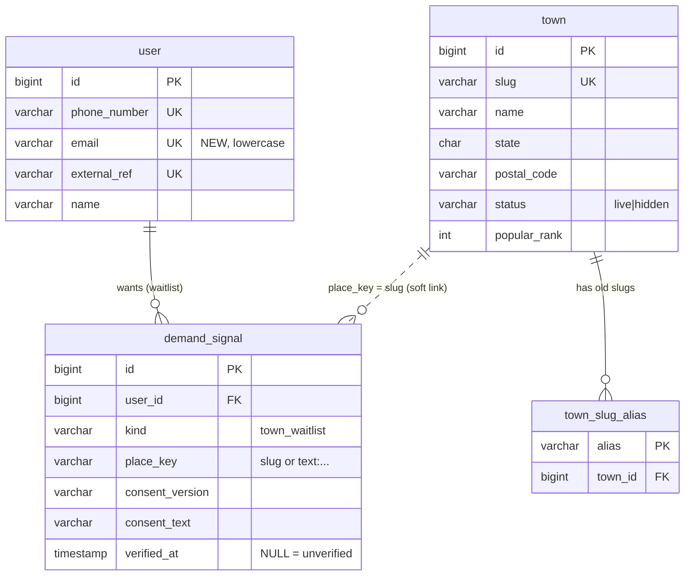
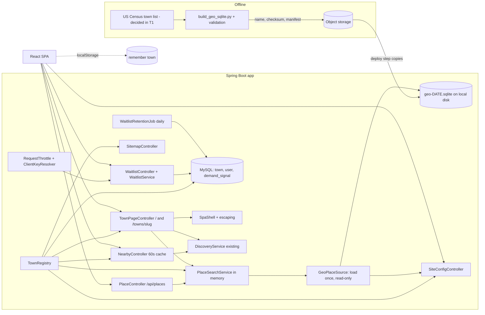
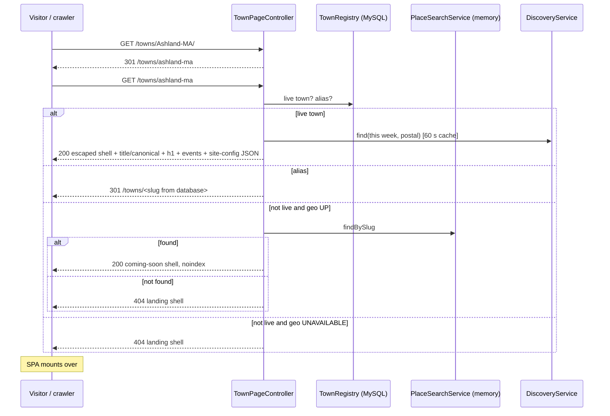
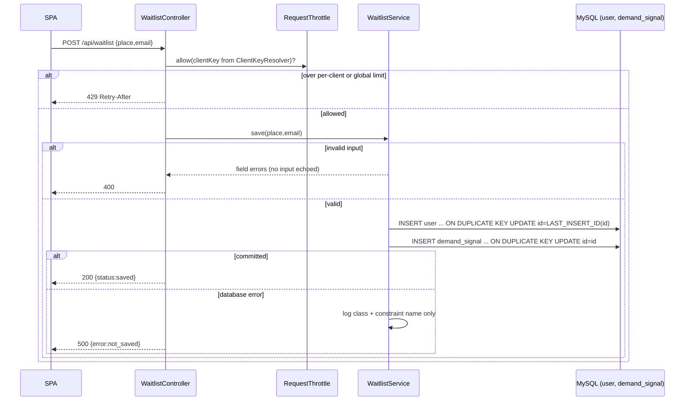
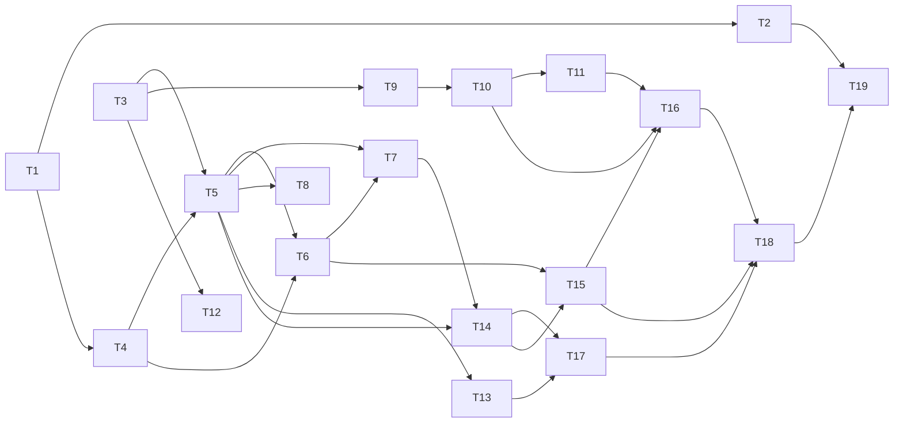

# Arangly — Town Entry & Coverage (P2.1) — SDD

> *How* P2.1 is built. It realizes `docs/p2.1-town-entry/trd.md` (REQ-P2.1-01..20). P2.1 does not
> change how events are queried or displayed once a town is chosen (P2). It changes how a visitor
> *gets to* a town (search, near me, town URLs, remember town), makes coverage **data** instead of a
> hard-coded list, captures demand for towns Arangly does not serve, and makes town pages discoverable.
> The supported region is **Massachusetts only** (driver decision). No application code is written until
> this design is approved.
>
> Chain: `UF → AC (PRD) → REQ (TRD) → T# (§8 here) → TC (TTP)`.

## 0. Phase 0 — technical unknowns, resolved or raised

| # | Unknown | Resolution | Alternatives considered |
|---|---------|------------|-------------------------|
| U1 | Where does "live town" status live, and where does the searchable place data live? | **Two stores, by nature of the data.** Coverage (which towns are live) is operational, editable data → **MySQL** (`town`). The set of all resolvable places is a read-only dataset built offline → **SQLite file** (§3). | The live flag inside the SQLite file (rejected: flipping a town live must not need a rebuild). Everything in MySQL (rejected: keeps an imported dataset in the operational database). |
| U2 | Where does a demand signal live? | **CONFIRMED (DD-P2.1-1):** the email is identity on `user`; the wish is a `demand_signal` row that points at the user. | Email only in `demand_signal`; email in `user_metadata`; a table per signal type (all rejected, see DD-P2.1-1). |
| U3 | How do crawlers see town content? | **CONFIRMED (DD-P2.1-3):** server-injected page shell. | Prerender at release; Node server rendering. |
| U4 | What does the Java SQLite driver need at runtime? | **UNVERIFIED — checked in T1.** Known risk: `sqlite-jdbc` extracts a native library to a temp folder at startup; a read-only root filesystem or a minimal container image can block this unless `org.sqlite.tmpdir` points to a writable folder. Also to check: read-only open (`mode=ro`) works; the image's C library (glibc vs musl) has a matching native build. Full-text search (FTS5) is **no longer needed** for P2.1 (DD-P2.1-11). | A pure-Java reader (only if the native driver cannot run in the target image). |
| U5 | Where do place names and states come from? | **Resolved by T1 and the driver (2026-11-01):** the **US Census 2024 town list** (county subdivisions) gives all 351 Massachusetts municipalities with names, state, and centre points. P2.1 does **not** link ZIPs to towns (ZIP search moved to P2.3), so no ZIP-to-state list is needed. | OpenStreetMap (350 of 351, ODbL share-alike on our derived file); a ZIP-prefix state rule (wrong for `05501`/`05544` and for Rhode Island in prefix `02`). |
| U6 | Does a second JDBC source break the MySQL data source? | **Designed around:** Spring Boot's data-source auto-configuration backs off if any `DataSource` bean exists. The SQLite connection is **not** a bean; `GeoPlaceSource` (§3.4) opens it, loads the data, and closes it. | A second `DataSource` bean with `@Primary` on MySQL (works, easy to break). |
| U7 | How is "one client" identified for throttling? | **Deployment configuration, not an assumption** (DD-P2.1-7). Verified: `server.forward-headers-strategy: framework` is set in `application.yml`; it honors forwarded proto/host but does not replace the connection address. Behind a proxy or tunnel every request then shares one address. The trusted header (Cloudflare `CF-Connecting-IP`, or a load balancer's header) is a setting; empty means "use the connection address". The AWS front door is **not decided** and is **not assumed**. | Trusting `X-Forwarded-For` by default (spoofable). |
| U8 | Where does the shell inject content in the built `index.html`? | Verified on 2026-11-01 in `src/main/resources/static/index.html` (a git-ignored build output, so it is not visible in the repository): it contains exactly `<div id="root"></div>` and a title `<title>Arang — Discover</title>`. The injector replaces `<title>[^<]*</title>` (a pattern, not a fixed string) and the root `div`. If either is missing at startup, the shell **fails closed**: it serves the unmodified SPA page and logs an error once. | HTML comment markers (build tools may strip comments). |
| U9 | What credit do the licenses require? | **Resolved by T1:** Census asks for a source citation → "Town data: U.S. Census Bureau". GeoNames, the source of the existing `zip-centroids.csv` used for event map pins, is **CC BY 4.0** (verified in its readme) → "ZIP data: GeoNames (geonames.org)" with a link. The credits are a list in the place file's `meta`; the GeoNames line is added there too, because the site uses that data. The `PostalGeoService` comment calling GeoNames public domain is corrected in T4. | Hard-coding the wording. |
| U10 | Is find-or-create by email safe under concurrent requests on MySQL? | **Designed: single atomic statement** (DD-P2.1-12). A "look up, insert, on duplicate look up again" sequence can fail on MySQL when it runs inside one transaction, because the second read uses the first read's snapshot (default REPEATABLE READ). The proof must run on **MySQL**, not H2. | Re-read in a new transaction (works, more code). |
| U11 | Does existing P2 code have the same race? | **Checked:** `ConsumerIdentityResolver.resolveWeb` uses look-up/insert/re-read, but its only caller (`InterestController`) runs it outside any transaction, so each statement commits on its own and the re-read sees the other row. **No bug today.** The pattern is fragile: it breaks if a transaction is ever added around it. No task; a code comment is added in T9. | Rewriting it now (no defect to fix). |

## 1. Data model

### 1.1 What is added to MySQL (Flyway `V3__p2_1_town_entry.sql`)
One column on `user` and three tables. All follow the generality steering.

```sql
-- Coverage registry: which towns Arangly serves. A town going live is an UPDATE, not a release.
-- 'coming soon' is NOT stored: it is derived (a resolvable place with no live town row).
CREATE TABLE town (
  id            BIGINT PRIMARY KEY AUTO_INCREMENT,
  slug          VARCHAR(80)  NOT NULL UNIQUE,          -- 'ashland-ma'  (URL: /towns/ashland-ma); never changes once published
  name          VARCHAR(80)  NOT NULL,                 -- 'Ashland'
  state         CHAR(2)      NOT NULL,                 -- 'MA'
  postal_code   VARCHAR(16)  NOT NULL,                 -- primary ZIP; what /api/discovery?location= uses
  latitude      DECIMAL(9,6) NOT NULL,
  longitude     DECIMAL(9,6) NOT NULL,
  map_zoom      TINYINT      NOT NULL DEFAULT 14,
  status        VARCHAR(16)  NOT NULL DEFAULT 'live',  -- 'live' | 'hidden'   (data, not an enum type)
  popular_rank  INT          NULL,                     -- non-null => shown as a "Popular" chip, ascending
  created_at    TIMESTAMP DEFAULT CURRENT_TIMESTAMP,
  updated_at    TIMESTAMP DEFAULT CURRENT_TIMESTAMP ON UPDATE CURRENT_TIMESTAMP,
  KEY idx_town_status (status)
);

-- Old slugs keep working after a rename or merge: /towns/<alias> -> 301 -> /towns/<slug>.   (REQ-P2.1-05)
CREATE TABLE town_slug_alias (
  alias    VARCHAR(80) PRIMARY KEY,
  town_id  BIGINT NOT NULL,
  FOREIGN KEY (town_id) REFERENCES town(id) ON DELETE CASCADE
);

-- Identity: an email is a contact identity, parallel to phone_number (stored lowercase, unique).
ALTER TABLE `user` ADD COLUMN email VARCHAR(254) NULL UNIQUE;

-- A recorded wish, pointing at the person. 'kind' is data: a future signal type is a new value, not a new table.
CREATE TABLE demand_signal (
  id               BIGINT PRIMARY KEY AUTO_INCREMENT,
  user_id          BIGINT       NOT NULL,
  kind             VARCHAR(32)  NOT NULL DEFAULT 'town_waitlist',
  place_key        VARCHAR(120) NOT NULL,   -- town slug when the visitor picked a place, else 'text:' + normalized typed text
  place_label      VARCHAR(80)  NOT NULL,   -- as shown or typed, for humans
  consent_version  VARCHAR(16)  NOT NULL,
  consent_text     VARCHAR(500) NOT NULL,   -- the exact wording the visitor was shown
  verified_at      TIMESTAMP    NULL,       -- NULL = unverified (always NULL in P2.1; a later sender must verify first)
  created_at       TIMESTAMP DEFAULT CURRENT_TIMESTAMP,
  UNIQUE KEY uq_demand (user_id, kind, place_key),   -- idempotent repeats (REQ-P2.1-11)
  KEY idx_demand_place (kind, place_key),             -- who wants this town (for a future "now live" notice)
  KEY idx_demand_created (created_at),                -- retention purge (REQ-P2.1-20)
  FOREIGN KEY (user_id) REFERENCES `user`(id) ON DELETE CASCADE
);
```
- **Seed:** the migration inserts the 28 current towns (slug, name, state, ZIP, point, zoom) from the SPA's hard-coded
  list, all in Massachusetts, all `status='live'`, with `popular_rank` 1–6 for Ashland, Framingham, Natick, Boston,
  Cambridge, Newton (matching the current landing chips). After it, the SPA reads towns from the server.
- **One additive change to `user` (`email`).** No change to `event` or any other P1/P2 table.
- **Existing `user` rows and code (checked):** `phone_number` is nullable and unique; the only reader of it is
  `UserDao.findByPhoneNumber` (grep of `src/main/java`). Rows without a phone exist **only for web visitors who saved
  interests** (P2 creates no row before that). `model/User` and the `UserDao` row mapper do not select `email` today;
  T9 adds it.
- **How a town becomes live (operator runbook, written in T19):** insert a `town` row with values taken from the place
  file (slug, name, state, point) plus the town's primary ZIP for the existing discovery query. A startup check (T5)
  logs a warning for any live `town` row whose slug is not in the place file or whose state disagrees with it.
- **Removal on request (operator runbook, T19):** delete the `user` row found by `email`; the cascade removes that
  person's signals. P2.1 never links an email user to a cookie user (DD-P2.1-1), so a waitlist-only user has no interests.

### 1.2 ER diagram

`demand_signal.place_key` is intentionally **not** a foreign key to `town`: it also holds places Arangly has not added
and free text (including out-of-state towns, which are not resolvable). When a town is later added, its signals are found
by `place_key = town.slug`. Signals stored as `text:` are not matched automatically; a later matching job is out of scope.
The full-schema diagram is in `docs/p2.1-town-entry/schema-erd.html`.

### 1.3 The SQLite place file (read-only artifact, not part of MySQL)
Built offline, never written by the app (§3). Illustrative schema (the build script owns the final form):
`place(id, source_id, name, search_name, type, state, slug, latitude, longitude)` — for P2.1 one row per
**Massachusetts municipality** (about 351; `type` = `city`|`town`, kept so villages can be added later without a schema
change); `meta(key, value)` with `schema_version`, `data_date`, `build_date`, `source_checksum`, `sources`, `credits`
(one line per source), `license_text`. **No ZIP tables in P2.1** (ZIP search is P2.3). No full-text index and no spatial index are needed for P2.1 (DD-P2.1-11).

## 2. Behavior → implementation (per REQ)

| REQ | Realized by |
|-----|-------------|
| 01 word-start search by town name; digits-only input → hint; Enter with one result opens it | `GET /api/places?q=` → `PlaceSearchService` in-memory word-start match (§3.4) (T6); SPA type-ahead and digits hint (T15) |
| 02 every MA municipality returns itself by exact name; exact match never dropped | Exact matches are always returned before the capped remainder (§3.4) (T6); build check: every place row finds itself (T2) |
| 03 near me → nearest live within limit; coordinates not persisted; invalid rejected | **In the browser** (DD-P2.1-6): SPA reads live towns + `nearMeMiles` from `site-config`, validates the numbers, computes distance (T15). Coordinates never leave the device |
| 04 location denied or unavailable | SPA message; search stays usable (T15) |
| 05 town URL; change town; old slug redirect; canonical without query | `TownPageController` (T7); alias → 301; SPA routing (T14) |
| 06 unknown/malformed → landing (404); not-live → coming soon; geo down → landing; case/slash → 301 | `TownPageController` decision table (§4.5) (T7); SPA states (T14) |
| 07 live status from data | `town.status` via `TownRegistry` (T5); read by shell, site-config, nearby, sitemap |
| 08 nothing-on state with nearby towns + submit link | `GET /api/towns/{slug}/nearby` (T13); SPA empty state (T17) |
| 09 coming soon for a picked not-live place; "not found in Massachusetts" + email for ≥3 chars with no match; nothing for 1–2 chars | SPA decision from `/api/places` results (T15, T16) |
| 10 durable signal, lowercased email, unverified, confirm only after stored | Atomic upsert of `user` (T9) + insert of `demand_signal` with `verified_at NULL` (T10); SPA shows "saved" only on 200 (T16) |
| 11 validation; failure keeps value; repeat is idempotent | `WaitlistService` validation + unique keys; a duplicate is success (T10); SPA keeps the value (T16) |
| 12 throttle; 429; configurable client identity; startup warning; no email reveal | `RequestThrottle` + `ClientKeyResolver` (T11); identical 200 body for new and repeat (T10) |
| 13 sitemap | `SitemapController` (T8) |
| 14 robots | `SitemapController` (T8) |
| 15 no email in logs (incl. DB errors), URLs, or responses | `WaitlistService` / `WaitlistController` error handling (§4.3) (T10); log-capture tests (T10, T18) |
| 16 remember town in the browser only | SPA `localStorage` (T14) |
| 17 page identity, script-safe server pages, brand | `SpaShell` with escaping rules (§4.5) (T7); brand strings in the SPA (T17) |
| 18 resilience when place data is missing | `GeoPlaceSource.status()` (T4); `/api/places` → 503 (T6); site-config `geo` + embedded towns (T5); SPA fallback (T15) |
| 19 credit; no third-party calls while typing; data date in health | `credits` from the file `meta` via site-config (T5); landing footer (T15); `/health.geo.dataDate` (T4) |
| 20 retention: delete signals at 24 months and waitlist-only users with their last signal | `WaitlistRetentionJob`, daily (T12) |

## 3. Place data: the SQLite file and how it is built, deployed, and read

### 3.1 Principle
Building the file is an **offline job**. The API server only **opens it read-only, loads it, and reads from memory**. No
download, conversion, table creation, or write happens in the API server.

### 3.2 Build (offline) — `scripts/geo/build_geo_sqlite.py` + README (T2), after the source evaluation (T1)
1. **Get the source data:** the US Census gazetteer county-subdivision file (decided in T1). Record URL, vintage,
   download date, checksum, and the citation.
2. **Keep only Massachusetts municipalities** (cities and towns) with name, state, and centre point. Villages and
   neighborhoods are excluded in P2.1.
3. **Clean names.** Remove the Census suffixes "town", "city", and "Town city" (for example "Agawam Town city" →
   "Agawam"). Drop the "County subdivisions not defined" water rows. *(No ZIP step in P2.1: ZIP linking moved to P2.3.)*
4. **Names and slugs.** Build `search_name` (lowercase, accents removed) and the slug `<name>-<state>`. **Pin slugs:**
   read the previous published file and keep every slug it had; a name change keeps the old slug (the app redirects via
   `town_slug_alias`). If two municipalities would share a slug, the build fails (the 351 names were verified unique in T1).
5. **Write** the SQLite file in `journal_mode=DELETE` (so a read-only open needs no side files), then the `meta` table.
6. **Validate; publish nothing on failure:** municipality count within the expected range (about 351); every
   row's Census ID starts with `25` (Massachusetts) and its point lies inside the Massachusetts bounds *(changed in T2:
   because the source is the Census list filtered by its own state code and ID, a polygon test adds nothing; a coarse
   bounding box remains as a sanity check)*;
   exactly 351 rows; names carry no administrative suffix; no empty names; slugs unique; every slug in the previous file
   still exists; all 28 seeded towns resolve with the right state; **every place returns itself** when searched by its
   exact name, using the same matching rules as the app (§3.4);
   `credits` is non-empty for every source used; the file opens read-only.
7. Name `geo-YYYY-MM-DD.sqlite`, compute the checksum, mark read-only, upload to object storage (S3), and update
   `manifest.json` (current file name + checksum). Keep the last few versions for rollback.

### 3.3 Deploy
A deploy step (container start script or image build — **not** Java code) reads `manifest.json`, copies the named file to
local disk, verifies the checksum, and sets `ARANG_GEO_FILE`. If the image has a read-only root filesystem, the deploy
also sets `org.sqlite.tmpdir` to a writable folder (U4). Local development runs the same script into a git-ignored
`data/geo/`. Rollback: point the manifest at the previous file and restart.

### 3.4 Read (in the app)
- **`GeoPlaceSource`** — at startup: if `arang.geo.file` is set and readable, open it read-only
  (`jdbc:sqlite:file:<path>?mode=ro`), check `meta.schema_version == 1`, **load all places into memory**, and
  close the connection. Status: `UP` with `dataDate`, `schemaVersion`, `credits`; or `UNAVAILABLE` with a reason from a
  fixed list (`NOT_CONFIGURED`, `NOT_FOUND`, `UNREADABLE`, `WRONG_VERSION`). **It never throws at startup.** It is not a
  `DataSource` bean (U6). The in-memory data is immutable; a new file needs a restart.
- **`PlaceSearchService.search(q)`** — first, on the trimmed raw text: if it is only digits, spaces, and `-` (for
  example a ZIP), return `{"results":[],"hint":"type_town_name"}` without searching *(ZIP search is P2.3)*. Otherwise
  normalize: lowercase, remove accents, replace punctuation with spaces, collapse spaces, and drop a trailing state word
  (`ma`, `mass`, `massachusetts`). A query that is empty after this step (for example only `ma`) returns an empty list,
  not a 400:
  - **Mixed letters and digits:** treated as text words.
  - **Text:** split into words; a place matches when **every** typed word is the start of some word in its
    `search_name`, in any order. A typed word that only matches the middle of a word does not match.
  - **Ranking:** (1) **exact matches** — the whole normalized name equals `q` — always returned,
    never cut; (2) then the other matches: live towns first, then by name. The limit of **8** applies to group (2) only.
  - Each row carries `live` from `TownRegistry`. No SQL is built from user text (matching runs in Java), so there is no
    query injection surface.
  - `findBySlug(slug)` returns a place or empty (used for the coming-soon decision).
- **Writes:** none, ever.

## 4. Contracts

### 4.1 `GET /api/site-config`
Also embedded in every HTML page as `<script id="site-config" type="application/json">`. The SPA reads the embedded copy,
and fetches this endpoint only when there is none (the Vite dev server has no shell).
```json
{
  "towns": [ { "slug":"ashland-ma","name":"Ashland","state":"MA","postal":"01721",
               "lat":42.2539,"lng":-71.4583,"zoom":14,"popularRank":1 } ],
  "nearMeMiles": 100,
  "consent": { "version":"v1", "text":"We'll only email you about Arangly in <town>." },
  "credits": [ "Town data: U.S. Census Bureau", "ZIP data: GeoNames (geonames.org), CC BY 4.0" ],
  "geo": "UP",
  "publicUrl": "https://arangly.com"
}
```
Only `status='live'` towns appear. `consent.text` is a template; the stored `consent_text` is the rendered string.
`credits` lists one line per data source the site uses. The GeoNames line stays while `zip-centroids.csv` powers the
event map pins.

### 4.2 `GET /api/places?q=<text>`
- `200` `{ "results":[ { "slug":"ashland-ma","name":"Ashland","state":"MA","live":true,"exact":true } ] }`
  — exact matches first (any number), then at most 8 others; empty list when nothing matches. For digits-only input:
  `{ "results":[], "hint":"type_town_name" }`.
- `400` `{ "error":"q_invalid" }` — empty after trim, or longer than 80 characters.
- `503` `{ "error":"geo_unavailable" }` — place data missing or wrong version (REQ-P2.1-18).

### 4.3 `POST /api/waitlist`
Request: `{ "place":"worcester-ma" | "Nashua", "email":"a@b.co" }`
- `200` `{ "status":"saved" }` — for a new record **and** for a repeat (byte-identical body).
- `400` `{ "errors": { "email":"invalid" } }` or `{ "errors": { "place":"invalid" } }` — never echoes the input.
- `429` `{ "retryAfterSeconds": 60 }` with `Retry-After`.
- `500` `{ "error":"not_saved" }` — nothing was stored.

**Server rules.**
- Validate: email trimmed, ≤ 254 characters, exactly one `@`, non-empty local and domain parts, no whitespace or control
  characters; `place` ≤ 80 characters. Normalize: the email is lowercased as a whole.
- `place_key`: if `place` equals a **live** `town.slug` → `400 {"errors":{"place":"invalid"}}` (a served town has no
  waitlist). If `place` is a slug in the place file → that slug. If place data is down and `place` has the slug
  shape (`[a-z0-9-]{1,77}-ma`), it is stored as that slug (the SPA only sends slugs it received from search), so it
  still matches the town later. Otherwise `'text:' + lowercased, whitespace-collapsed text`.
- **Atomic find-or-create (DD-P2.1-12):**
  ```sql
  INSERT INTO `user` (email, created_at, updated_at) VALUES (:email, NOW(), NOW())
    ON DUPLICATE KEY UPDATE id = LAST_INSERT_ID(id);
  -- SELECT LAST_INSERT_ID() → the user id, new or existing
  INSERT INTO demand_signal (user_id, kind, place_key, place_label, consent_version, consent_text)
    VALUES (...) ON DUPLICATE KEY UPDATE id = id;          -- repeat = no-op
  ```
  Both statements run in one transaction; on success the controller returns 200. `ON DUPLICATE KEY UPDATE` with an
  unchanged value does not change `updated_at`. The cookie identity (`arang_uid`) is not read or linked.
- **No email in logs (REQ-P2.1-15).** `WaitlistService` catches `DataAccessException`. It logs a fixed message with the
  exception class name and the constraint name only — never the exception object, its message, or its cause, because
  MySQL's text includes the value (`Duplicate entry '…' for key …`). `WaitlistController` has its own exception handler
  for every exception type, returning `500 not_saved`, so nothing reaches Spring's or Tomcat's default error logging.
  The email travels only in the POST body; no filter logs request bodies.
- **Throttle (DD-P2.1-7).** `ClientKeyResolver`: if `arang.site.client-ip-header` is set, use that header's value; if
  the header is missing on a request, use the connection address. `RequestThrottle`: 5 requests per minute per client
  key, plus a global ceiling (100 per minute across all clients); the per-client map is bounded (maximum entries, expiry
  after the window). *Trade-off (accepted, P4 to revisit):* one abuser with many addresses can use up the global
  ceiling and block real visitors for the rest of that minute; the ceiling protects the database and the email
  list from a flood, which matters more before real hardening exists. At startup, if `arang.site.public-url` is not a localhost address and no client-ip header is set,
  the app logs a clear warning that all visitors may share one throttle bucket.

### 4.4 `GET /api/towns/{slug}/nearby?from=&to=`
Up to 3 *other* live towns within `nearMeMiles` that have ≥ 1 published event in the window, nearest first:
`{ "towns":[ { "slug","name","state","distanceMiles","eventCount" } ] }`. `404` for an unknown or hidden slug. The
window defaults to this week, as `/api/discovery` does. `from` and `to` are validated (`from` ≤ `to`, span at most 31
days; else `400`). Only the **default window** is cached (60 seconds per slug, at most one entry per live town), because
the existing `DiscoveryService.find` loads all events and filters them in memory on every call (checked). Other windows
are computed on demand and not cached, so callers cannot fill memory with cache entries.

### 4.5 `GET /` and `GET /towns/{slug}` (HTML)
**Decision table for `/towns/{slug}`:**

| Case | Status | Body |
|------|--------|------|
| path has uppercase letters or a trailing slash | 301 | `Location: /towns/<lowercase slug>` |
| slug is a live town | 200 | Shell for the town: title, canonical, description, `h1`, and this week's events as plain HTML |
| slug is an alias of a live town | 301 | `Location` built from the **database** slug, never from the request path |
| slug is an alias of a hidden town | 200 / 404 | Same as the hidden town's own slug: coming-soon shell + noindex if geo `UP`; 404 landing shell if geo `UNAVAILABLE` |
| geo `UP` and slug is a place-file slug with no live town | 200 | Shell for the coming-soon state, `<meta name="robots" content="noindex">` |
| geo `UNAVAILABLE` and slug is not a live town or alias | 404 | Shell for the landing |
| unknown or malformed slug (not matching `[a-z0-9-]{1,80}`) | 404 | Shell for the landing (DD-P2.1-5) |

- The canonical URL never includes the query string. Paths with `//` or encoded slashes are rejected as malformed.
- `GET /` returns the landing shell: title, canonical, description, and plain links to every live town.
- **Escaping rules (REQ-P2.1-17):** event titles and locations come from WhatsApp, OCR, and AI output, so they are
  untrusted. Text placed in HTML is HTML-escaped. Text placed in attributes (title, description) is attribute-escaped.
  The embedded JSON is serialized by the JSON library and then has `<`, `>`, `&`, U+2028, and U+2029 replaced by
  `\u` escapes, so no data can close the `<script>` element. **Links:** the server page renders no link that comes
  from event data; its only links are to `/towns/<slug>` paths built from the database. The replacement string for the
  title pattern is passed through `Matcher.quoteReplacement`, so `$` or `\` in a town name cannot change the
  replacement.
- **Caching (driver agreed, 60 seconds):** responses carry `Cache-Control: public, max-age=60`. The server caches the
  rendered page per (slug) for 60 seconds. The server page ignores the `arang_uid` cookie: it shows the unfiltered events
  of the week, and the SPA applies saved interests after it loads. The same 60-second window applies to the sitemap
  and to the embedded site-config, so a town going live or hidden can take up to 60 seconds to appear (PRD A11, REQ-13).

### 4.6 `GET /sitemap.xml`, `GET /robots.txt`
Sitemap: the landing URL plus `<publicUrl>/towns/<slug>` for each live town; no `lastmod`. Robots: `Disallow` for
`/add`, `/submit`, `/console`, `/review/`, `/api/`, `/webhook/`, `/media/`, `/tiles/`, `/health`, `/actuator/`, and
`Sitemap: <publicUrl>/sitemap.xml`. `publicUrl` is `arang.site.public-url` (env `ARANG_SITE_PUBLIC_URL`, default
`http://localhost:8080`; production `https://arangly.com`). T8 removes the static templates in `deploy/cloudflare/`.

### 4.7 `GET /health` (additive)
Adds `"geo": { "status":"UP"|"UNAVAILABLE", "dataDate":"2026-11-01", "schemaVersion":1, "reason":"NOT_FOUND" }`.
`reason` comes only from the fixed list in §3.4 — no file paths or exception text, because the endpoint is public. The
top-level `status` stays `UP`. The stale `"phase":"P1-skeleton"` value is updated in T4.

## 5. Diagrams

### 5.1 Components


### 5.2 Town page request (REQ-P2.1-05, 06, 07, 17)


### 5.3 Waitlist submit (REQ-P2.1-10, 11, 12, 15)


## 6. Module / package structure
Backend (`com.arang.intake`):
- `geo/GeoPlaceSource.java`, `geo/GeoProperties.java`, `geo/PlaceSearchService.java`, `geo/Place.java`
- `town/TownRegistry.java`, `town/Town.java`
- `controller/PlaceController.java`, `SiteConfigController.java`, `TownPageController.java`, `NearbyController.java`,
  `SitemapController.java`, `WaitlistController.java`
- `web/SpaShell.java`, `web/HtmlEscaper.java` (or the Spring `HtmlUtils` equivalent)
- `waitlist/WaitlistService.java`, `waitlist/RequestThrottle.java`, `waitlist/ClientKeyResolver.java`,
  `waitlist/WaitlistRetentionJob.java`, `dao/DemandSignalDao.java`; `dao/UserDao.java` + `model/User.java` gain `email`
- `controller/HealthController.java` (extend), `db/migration/V3__p2_1_town_entry.sql`
- `build.gradle`: `runtimeOnly 'org.xerial:sqlite-jdbc:<pinned version>'` (version fixed in T1)

Front end (`web/src`): `router.js`, `siteConfig.js`; changes to `App.jsx`, `Landing.jsx`, `Discovery.jsx`,
`discoveryApi.js`, `index.css`. Scripts: `scripts/geo/build_geo_sqlite.py`, `scripts/geo/README.md`.

Test seams (from TTP-D2): a `java.time.Clock` bean is injected into `RequestThrottle`, the page and nearby caches, and
`WaitlistRetentionJob`; production uses the system clock. Build additions (TTP-D1, TTP-D3): Vitest as a pinned dev
dependency in `web/` (T14), and a Gradle task `mysqlIntegrationTest` for the real-MySQL cases (T9).

Config keys: `arang.geo.file`; `arang.site.public-url`; `arang.site.near-me-miles` (100);
`arang.site.client-ip-header` (empty = connection address); `arang.site.page-cache-seconds` (60);
`arang.waitlist.rate-per-minute` (5); `arang.waitlist.global-rate-per-minute` (100);
`arang.waitlist.retention-months` (24); `arang.waitlist.consent-version` / `consent-text`; JVM `org.sqlite.tmpdir`.

## 7. Checks (feed the TTP)

| REQ | Check |
|-----|-------|
| 01 | `q=ma` returns an empty list (200); `q=ash` returns Ashland; `q=north and` returns North Andover; `q=Ashland, MA` returns Ashland; **`q=land` does not return Ashland**; `q=01721` and `q=01721-1234` return no results and `hint=type_town_name`, and the UI shows the hint, not "not found"; 81 characters → 400; no more than 8 non-exact results; UI: Enter with one suggestion opens it |
| 02 | Build check: every place returns itself by exact name. App test: a fixture with more than 8 matching names still returns the exact match first |
| 03 | **Client unit test:** out-of-range or non-numeric coordinates are rejected. Browser test: mocked position in Framingham → Framingham opens; far away → message, no navigation; no request carries the coordinates |
| 04 | Browser test: permission denied → message, search usable, no error page |
| 05 | Fresh browser: `/towns/ashland-ma` shows Ashland with no landing step; change town → landing; alias → 301 to the database slug; `?window=…` leaves canonical unchanged |
| 06 | `/towns/zzz` → 404 + landing; `/towns/Ashland-MA` and `/towns/ashland-ma/` → 301; not-live place slug → coming soon + noindex; same slug with geo down → 404 + landing; `//` → 404 |
| 07 | Set a test town to `hidden` → gone from site-config, search `live` flag, sitemap; its page becomes coming soon (geo up) |
| 08 | Live town with no events and a neighbor with events → nearby list shows the neighbor; `/submit` link present; no coming-soon text; `from` > `to` or a span over 31 days → 400; requests with many different windows leave at most one cache entry per live town |
| 09 | Pick a not-live suggestion → coming soon; type "Nashua" (3+ chars, no match) → after the pause, "not found in Massachusetts" + email form, no coming-soon claim; type "xq" → no message; a slow response for older text never replaces the result for newer text |
| 10 | Valid post → `user` row with lowercase email + `demand_signal` row with consent text, time, `verified_at` NULL; UI shows saved only after 200 |
| 11 | Invalid email → 400 + value kept; database stopped → 500, no saved state; same email + place twice → one user, one signal, identical 200; same email, second place → one user, two signals; **on MySQL (`arang_dev`)**, two parallel requests with a new email → one user row |
| 12 | Six requests in a minute from one key → sixth gets 429 + UI message; posting a live town's slug → 400; with place data down, posting `worcester-ma` stores `place_key = worcester-ma` (not `text:`); with `client-ip-header` set, two different header values get separate buckets; header missing → connection address used; public URL set and header unset → startup warning logged; global ceiling enforced |
| 13 | Sitemap = landing + exactly the live towns; none of the excluded prefixes; after toggling a town, the sitemap shows the change within 60 seconds |
| 14 | Robots has every exclusion line and the `Sitemap:` line |
| 15 | Capture all logs at INFO and above; post emails; force a duplicate **and** a non-duplicate database error whose message contains the email; post **malformed JSON** containing an email → the address never appears (with `spring.mvc.log-resolved-exception=false` confirmed); no endpoint returns a stored email |
| 16 | Choose a town, reload `/` → that town opens; press "change town" → landing, and a reload stays on the landing; set the remembered town to a hidden or unknown slug → landing and the value is cleared; clear site data → landing; across the whole flow, no cookie holds the choice and no request carries it except the one that opens the town (`/towns/<slug>` or its data calls) |
| 17 | Fetch a town page with scripts off: title, canonical, description, `h1`, events present. **Fixture events titled `</script><script>alert(1)</script>` and `">`, and one with a `javascript:alert(1)` link in its metadata,** render as text and run nothing; a town name containing `$1` renders literally. No screen shows "Arang" without "ly". Missing injection markers → unmodified page + one error log |
| 18 | Start with `ARANG_GEO_FILE` unset, missing, unreadable, and wrong version: app starts, other pages work, `/api/places` → 503, landing shows embedded live towns, `/health.geo` shows the matching fixed reason and no path |
| 19 | Landing footer shows every credit line; typing produces requests only to our origin; `/health.geo.dataDate` equals the file's date |
| 20 | Seed signals 23 and 25 months old → job deletes only the 25-month one; a user with no phone, no `external_ref`, no interests, and no remaining signals is deleted; a user with interests is kept |

## 8. Dependency-ordered tasks (D5)
> Target per task: 1 concern / ≤ 3 source files (tests and `build.gradle` not counted) / 1 test run. **19 tasks.** The
> driver accepted about 16. The sizes are approximate: T4 and T9 touch about 4 files each, and T19 combines related
> operational work. Brand strings are done in each screen's own task, so no task edits another task's screen.

- **T1 — Place-data source evaluation (spike). DONE 2026-11-01** (result under DD-P2.1-4). Compare OSM (preferred) with US Census gazetteer files, MassGIS, and
  GeoNames for the 351 municipalities: coverage, accuracy against the 28 seeded towns, license and credit terms (incl. ODbL
  share-alike), effort. Choose the authoritative ZIP-to-state list. Check name forms (administrative suffixes). Check the
  SQLite driver (U4: native library, temp folder, read-only open). **Output:** a decision
  note appended to this SDD (§9 DD-P2.1-4) and a pinned driver version. No app code. *(REQ-02, 19; U4, U5, U9)*
- **T2 — Build script and validation. DONE 2026-11-03:** `scripts/geo/build_geo_sqlite.py`, its 8 unit tests, and a real
  build (351 places, 70 KB). The self-search check runs the Python copy of the matching rules; the Java parity check is in
  T6. Was: `scripts/geo/build_geo_sqlite.py`, README, and every check in §3.2 step 6;
  produces a validated `geo-*.sqlite`. Depends on T1. *(REQ-02, 18, 19)*
- **T3 — Migration V3 + seed. DONE 2026-11-03:** applied on H2 (5 tests) and on `arang_dev` MySQL (Flyway v3). Was: `V3__p2_1_town_entry.sql` and a test that applies it and checks the seed; existing user
  tests still pass. *(REQ-07, 10, 11, 20)*
- **T4 — Place-file reader + health. DONE 2026-11-04:** `GeoPlaceSource` (loads once, read-only, never fails at
  startup), `GeoProperties`, `Place`, extended `HealthController`; added `org.xerial:sqlite-jdbc:3.54.1.0`; corrected the
  `PostalGeoService` GeoNames comment. 6 new tests; dev `/health.geo` = UP with the data date. Was:
  (`org.xerial:sqlite-jdbc:3.54.1.0`); correct the `PostalGeoService` comment (GeoNames is CC BY 4.0, not public domain). Tests:
  each `UNAVAILABLE` reason and a good file. Depends on T1. *(REQ-18, 19)*
- **T5 — Town registry + site-config.** `TownRegistry`, `Town`, `SiteConfigController` (live list, aliases, credits,
  startup consistency warning against the place file). Depends on T3, T4. *(REQ-07, 18, 19)*
- **T6 — Places search API.** `PlaceSearchService`, `PlaceController`: word-start matching, exact-first ranking, cap,
  400/503. Depends on T4, T5. *(REQ-01, 02, 09, 18)*
- **T7 — Page shell + town pages. DONE 2026-11-04:** `SpaShell`, `HtmlEscaper`, (escaping, fail-closed, page titles with the brand), `TownPageController`
  (decision table, redirects, 60 s cache), `WebConfig`. Depends on T5, T6. *(REQ-05, 06, 17)*
- **T8 — Sitemap and robots. DONE 2026-11-04:** `SitemapController`; delete `deploy/cloudflare/*`. Depends on T5. *(REQ-13, 14)*
- **T9 — User email support. DONE 2026-11-04:** `User`, `UserDao` (atomic upsert, `findByEmail`), comment on `ConsumerIdentityResolver`
  (U11); concurrency test on MySQL. Depends on T3. *(REQ-10, 11)*
- **T10 — Waitlist API. DONE 2026-11-04:** `WaitlistController`, `WaitlistService`, `DemandSignalDao`: validation, place key, idempotency,
  error handling with no email in logs. Depends on T9. *(REQ-10, 11, 15)*
- **T11 — Throttle and client identity. DONE 2026-11-04:** `RequestThrottle`, `ClientKeyResolver`, startup warning. Depends on T10.
  *(REQ-12)*
- **T12 — Retention job. DONE 2026-11-04:** `WaitlistRetentionJob` (daily) and its test. Depends on T3. *(REQ-20)*
- **T13 — Nearby towns API. DONE 2026-11-04:** `NearbyController` with the 60 s cache. Depends on T5. *(REQ-08)*
- **T14 — SPA routing, server town data, remember town. DONE 2026-11-04:** `router.js`, `siteConfig.js`, `App.jsx`: "change town"
  clears the remembered town; a stale remembered town is cleared. Depends on T5, T7. *(REQ-05, 06, 16)*
- **T15 — SPA landing search, near me, not found, credit, landing brand. DONE 2026-11-04:** `Landing.jsx`, `discoveryApi.js`,
  `index.css`. Debounce and latest-response-wins for "not found". Depends on T6, T14. *(REQ-01, 03, 04, 09, 17, 18, 19)*
- **T16 — DONE 2026-11-04. SPA waitlist form (coming soon and "not found in Massachusetts").** `Landing.jsx` form states,
  `discoveryApi.js`. Depends on T10, T11, T15. *(REQ-09, 10, 11, 12)*
- **T17 — SPA discovery screen: nothing-on state and discovery-screen brand. DONE 2026-11-04:** `Discovery.jsx`. Depends on T13, T14.
  *(REQ-08, 17)*
- **T18 — End-to-end tests. DONE 2026-11-04:** Playwright flows for the TTP, the network-request check (REQ-19), and the log-capture check
  (REQ-15) against dev. Depends on T15–T17. *(all)*
- **T19 — Deploy step, release script, runbooks. DONE 2026-11-04:** Geo-file deploy step, release-script update, operator runbooks (make a
  town live, remove a person on request), STATUS.md, and the P2 doc pointers (P2 SDD DD-P2-3, DD-P2-9, DD-P2-11 point to
  this feature where it supersedes them). Depends on T2, T18. *(REQ-18, 19, 20)*


**First runnable slice:** T1 → T3 → T4 → T5 → T6 → T7 → T8 → T14 — coverage as data, town URLs with crawlable pages,
sitemap and robots, and SPA routing with remember-town. It works without a place file (geo `UNAVAILABLE`), apart from
the T1 driver check. Then the search slice (T2, T6, T15), the waitlist slice (T9–T12, T16), and the discovery slice
(T13, T17) can run in parallel.

**REQ ↔ task coverage:** 01→T6,T15 · 02→T1,T2,T6 · 03→T15 · 04→T15 · 05→T7,T14 · 06→T7,T14 · 07→T3,T5 ·
08→T13,T17 · 09→T6,T15,T16 · 10→T3,T9,T10,T16 · 11→T3,T9,T10,T16 · 12→T11,T16 · 13→T8 · 14→T8 · 15→T10,T18 ·
16→T14 · 17→T7,T15,T17 · 18→T2,T4,T5,T6,T15,T19 · 19→T1,T2,T4,T5,T15,T19 · 20→T3,T12,T19. Every REQ has a task and a
check (§7); every task traces to a REQ.

## 9. Design decisions
- **DD-P2.1-1 — Demand signal storage. CONFIRMED (2026-11-01).** Email is identity on `user` (nullable unique, lowercase);
  the wish is a `demand_signal` row referencing the user with `kind`, `place_key`, consent, and `verified_at`. P2.1 does
  not link the email user to the cookie identity. *Rejected:* email only in `demand_signal`; email in `user_metadata`; a
  table per signal type.
- **DD-P2.1-2 — Coverage lives in MySQL (`town`).** **CONFIRMED (driver, 2026-11-01).** Live status must change without a release (REQ-07).
  *Rejected:* a config file in the repo.
- **DD-P2.1-3 — Crawlable pages by server-injected shell. CONFIRMED (2026-11-01).** *Rejected:* prerender at release
  (stale within a day); Node server rendering.
- **DD-P2.1-4 — Place-data source. CONFIRMED (driver, 2026-11-01): the US Census town list for P2.1; no ZIP linking in
  P2.1.** The rule was "OpenStreetMap preferred; a free alternative wins only if it is better". T1 showed Census is better
  for P2.1. The driver then moved ZIP search to P2.3, so the Census ZIP-relationship file and GeoNames ZIP linking are not
  used here; that evidence is kept below and copied to `docs/p2.3-place-search/prd.md`.
  - **T1 outcome (2026-11-01) — evidence (decision recorded above).** Evidence from files downloaded to `/tmp/arang-t1`
    (not committed):
    | Source | Coverage of the 351 MA municipalities | ZIP data | License (how verified) |
    |---|---|---|---|
    | **US Census 2024 gazetteer, county subdivisions** | **351 of 351**; names unique after removing the suffixes "town", "city", "Town city"; all 28 seeded towns found; internal points within 0.0–1.1 mi of the seeded points (Newton 1.8, Boston 2.9 — Boston's point lies toward the harbor) | none | US federal government work, generally not under copyright (17 U.S.C. §105 — general law; the census.gov citation page asks for a source citation but does not state "public domain") |
    | **US Census 2020 ZCTA ↔ county-subdivision relationship file** | 347 of 351 by ID; the other 4 (Amesbury, Easthampton, Methuen, Watertown) changed IDs after 2020 and match by name | 540 MA ZIP areas (ZCTAs); 1 crosses into RI (`02861`) | same as above |
    | **GeoNames US postal codes** (already the source of `zip-centroids.csv`) | place names are postal city names: 488 of 685 MA ZIPs name a municipality, 197 name a village or neighborhood (e.g. Jamaica Plain) | 685 MA ZIPs **with state**, including PO-box and single-organization ZIPs; `05501`/`05544` correctly MA | **CC BY 4.0, credit with a link to geonames.org** (verified in the file's own `readme.txt`). The code comment in `PostalGeoService` calling it public domain is **wrong** |
    | **OpenStreetMap** (one Overpass query, admin_level 8) | 350 of 351 (Nantucket missing at that level); names identical to Census | almost none (1 relation has a postal code) | ODbL (read on osmfoundation.org): attribution required; a systematic extract of more than 100 features is "Substantial", so our derived place file would be a Derivative Database and we would have to offer it under ODbL on request |
    | **MassGIS municipalities** | 351 (per its data page; not downloaded) | a separate ZIP layer exists (not downloaded) | public domain, credit requested as "MassGIS (Bureau of Geographic Information), Commonwealth of Massachusetts EOTSS" (read on mass.gov FAQ) |
    **Combined check:** Census municipalities + Census ZCTA links + GeoNames ZIPs named for a municipality → **every one of the
    351 municipalities has at least one ZIP**; 636 ZIPs linked; 165 ZIPs touch two or more towns (many are slivers — T2 should
    set a minimum land-overlap share before linking); every seeded town's ZIP is linked to that town.
    **Recommendation:** for P2.1 use **Census** (municipality list, names, points, ZIP links) **+ GeoNames** (ZIP state and
    PO-box ZIPs, already bundled). **Do not use OSM for P2.1:** it adds nothing P2.1 needs (no ZIPs, identical names, one town
    missing) and would bring the ODbL share-alike duty. This meets the PRD rule "OSM preferred unless a free alternative is
    better". OSM, or MassGIS address points (public domain), stays the candidate for P2.2 addresses and venues.
    **Credits list:** "Town data: U.S. Census Bureau" and "ZIP data: GeoNames (geonames.org), CC BY 4.0" with a link.
    **ZIP-to-state list:** GeoNames state field, cross-checked against the Census ZCTA relationship (MA only).
    **SQLite driver:** `org.xerial:sqlite-jdbc:3.54.1.0` (SHA-1 `b74a59de3ae1dbab7c550fe7c46099980261a676`, matched Maven
    Central). Verified on this Mac (Apple Silicon, JDK 25): read-only open with `mode=ro` works and writes fail with
    `SQLITE_READONLY`; a file with `journal_mode=DELETE` creates no side files; with an unwritable temp folder the native
    library **fails to load**, and setting `org.sqlite.tmpdir` to a writable folder fixes it. The jar contains native
    builds for Linux glibc and musl on x86_64 and aarch64. **Not verified:** a run inside a Linux container or on AWS.
- **DD-P2.1-5 — Unknown town URL → HTTP 404 with the landing body.** **CONFIRMED (driver, 2026-11-01).** Visitors see the landing; crawlers get a
  real 404.
- **DD-P2.1-6 — Near me runs in the browser.** **CONFIRMED (driver, 2026-11-01).** Coordinates never leave the device. *Revisit* if live towns
  grow to thousands.
- **DD-P2.1-7 — Throttle in memory, per instance, with configurable client identity.** **CONFIRMED (driver, 2026-11-01).** No Redis before P4.
  Client identity is a deployment setting (header name or none), because the production front door is not decided (the
  driver stated that AWS cannot be assumed). For the current Mac + Cloudflare tunnel, the header is safe only if the app
  is reachable solely through the tunnel; binding the prod app to `127.0.0.1` would ensure that — a prod change, made only
  at an explicit prod release. *Limit:* several instances each apply their own limits.
- **DD-P2.1-8 — Site base URL is its own setting (`arang.site.public-url`).** **CONFIRMED (driver, 2026-11-01).** It differs from the WhatsApp
  review-link base.
- **DD-P2.1-9 — SQLite outside the DataSource mechanism.** **CONFIRMED (driver, 2026-11-01).** See U6.
- **DD-P2.1-10 — No router library in the SPA.** **CONFIRMED (driver, 2026-11-01).** *Revisit* when P2.2 adds event routes.
- **DD-P2.1-11 — Search runs in memory over the municipalities.** **CONFIRMED (driver, 2026-11-01).** About 351 places fit in memory easily; Java matching gives exact word-start rules, removes the need for FTS5 and its query
  syntax (no injection surface), and makes the build check and the app use the same code path. The SQLite file stays the
  artifact so P2.2 can add address tables and query them with SQL. *Revisit* if villages and neighborhoods are added and
  the place count grows by orders of magnitude.
- **DD-P2.1-12 — Atomic upsert for find-or-create by email.** **CONFIRMED (driver, 2026-11-01).** See U10. *Rejected:* look-up,
  insert, re-read.
- **DD-P2.1-13 — 60-second caching of town pages and nearby results. CONFIRMED (driver, 2026-11-01).**
- **DD-P2.1-14 — Retention job and unverified marker. CONFIRMED (driver, 2026-11-01).** Daily job; 24 months
  (configurable); `verified_at` NULL until a later phase verifies addresses.

## 10. Alternatives considered (kept lean)
Live public Nominatim (forbidden for type-ahead, 1 request per second); self-hosted Nominatim or Photon (more to operate;
escalation path for P2.2 addresses); a managed geocoding service (cost and storage rules; revisit for P2.2); places in
MySQL; FTS5 search in SQLite (not needed at this size, adds query-syntax risk); Elasticsearch/OpenSearch; a separate geo
service; a two-digit ZIP-prefix state rule (wrong, see U5).

## 11. Post-design steering re-check
- **Generality:** coverage, demand (`kind`), and verification state are data; places are build output with a `type`
  column ready for villages. ✔
- **Intake-as-data:** not touched. ✔
- **Identity vs role:** email is identity on `user`; the wish is a separate row; no role-like data on `user`. ✔
- **Stack:** Java + Spring Boot, MySQL, Gradle; one new runtime dependency (SQLite driver). The offline build script is
  Python, a development tool, not part of the server. ✔
- **Environments:** all work and tests on dev; prod only by explicit release. ✔

## 12. Open items that block approval or launch
1. ~~Proposed decisions~~ — **all confirmed by the driver (2026-11-01).**
2. **T1 outcomes (block launch):** chosen place source, verified licenses and credit lines (incl. ODbL share-alike), SQLite
   driver runtime checks.
3. **Production client identity (blocks launch of the waitlist):** set `arang.site.client-ip-header` per deployment and
   make sure the app is reachable only through that proxy. The AWS front door is undecided (owner: driver, at AWS deploy).
4. ~~Task count~~ — **19 tasks accepted by the driver (2026-11-01).**
5. **Size:** TRD has 20 REQs (5 over the guideline). The driver chose to keep one feature.

## 13. Version history
- **v0.1 (2026-11-01) — DRAFT.** First design from TRD v0.4: three tables, offline-built read-only SQLite place file,
  12 tasks, 10 proposed decisions.
- **v0.2 (2026-11-01) — DRAFT.** Driver challenged where the email lives: the email moved to `user`; `demand_signal`
  references the user.
- **v0.3 (2026-11-01) — DRAFT.** Driver confirmed DD-P2.1-1 and DD-P2.1-3. *(Correction recorded in v0.4: the v0.3 note
  said the PRD still listed OQ-P2.1-4 as open; the PRD was updated the same day.)*
- **v0.4 (2026-11-01) — DRAFT.** Applied the independent review (NEEDS-CHANGES) and the driver's decisions:
  **H1** Massachusetts only, state never from ZIP prefix, non-MA and IRS ZIPs dropped (U5, §1.3, §3.2); **H2** word-start
  matching (§3.4); **H3** exact matches never cut, build check that every place finds itself (§3.2, §3.4); **H4** atomic
  upsert, MySQL concurrency test (U10, DD-12, §4.3); **H5** client identity as deployment configuration, bounded map,
  global ceiling, startup warning, AWS not assumed (U7, DD-7, §4.3); **H6** place source evaluated in T1 with OSM
  preferred, credits as a list, ODbL share-alike check restored (U9, DD-4); **H7** database error text never logged,
  controller-level exception handling, log-capture test with forced failures (§4.3, §7). Medium and low fixes: in-memory
  search (DD-11) removing FTS5 and its injection surface; escaping rules and an XSS fixture; fail-closed injection with a
  title pattern; 60-second page and nearby caches (DD-13, driver agreed); retention job and `verified_at` (DD-14, driver
  agreed); decision table for geo-down, case, slash, `//`, and alias redirects built from the database; slug pinning
  across rebuilds; startup consistency check between `town` and the place file; fixed health reasons; SQLite runtime
  checks (temp folder, read-only open, journal mode); precise statement of existing `user` rows; ConsumerIdentityResolver
  checked (no bug today, U11); tasks split to 19 with a dependency graph; corrected cross-references. Driver's PRD-level
  decisions reflected: non-MA text gets the "only in Massachusetts" message with email capture; villages and
  neighborhoods later.
- **v0.5 (2026-11-01) — DRAFT.** Applied the second gate (PASS-WITH-FIXES): "change town" clears the remembered town and
  a stale remembered town is cleared (T14, check 16) — the new HIGH; authoritative ZIP-to-state list, polygon test,
  every municipality has a ZIP, name-suffix check (§3.2, T1); search normalization for punctuation, state word, long digit
  strings, mixed text (§3.4); credits always include GeoNames (U9, §4.1); `zip` field defined (§4.2); live-town slug
  rejected and slug-shaped keys kept when place data is down (§4.3); global-ceiling trade-off stated (§4.3); nearby window
  validated and only the default window cached (§4.4); no data-derived links and `quoteReplacement` (§4.5); 60-second
  sitemap delay stated (§4.5); checks 01, 09, 12, 13, 15, 16, 17 extended; first slice includes T6; brand moved into each
  screen's task; task sizes stated as approximate; P2 doc pointers added to T19; U8 marked verified on the git-ignored
  build output.
- **v0.5a (2026-11-01):** Driver confirmed the change-town rule and the 19-task plan.
- **v0.5b (2026-11-01):** Third gate (PASS-WITH-FIXES) fixes: ZIP+4 detected before punctuation removal and an empty
  normalized query returns an empty list (N1); alias-of-hidden-town row in the decision table (N5); checks 01, 08, 12,
  16 extended (N3, N4).
- **v0.5c (2026-11-01):** Driver confirmed DD-P2.1-2, 4–12 (all recommendations accepted). Every design decision is now confirmed.
- **v0.5 APPROVED (2026-11-01).** Driver sign-off of SDD v0.5 (incl. v0.5a–c), after three independent review gates. All 14 design decisions confirmed. The build may begin with the first slice (T1 → T3 → T4 → T5 → T6 → T7 → T8 → T14), on dev only.
- **v0.5d (2026-11-01):** Added the test seams accepted in the TTP: injectable `Clock` (T7, T11, T12, T13), Vitest in
  `web/` (T14), and the `mysqlIntegrationTest` Gradle task (T9). No behavior change.
- **v0.5e (2026-11-01):** T1 spike result recorded under DD-P2.1-4 (recommendation: Census + GeoNames for P2.1, no OSM; driver pinned at sqlite-jdbc 3.54.1.0). Awaiting the driver's decision.
- **v0.6 (2026-11-01) — APPROVED revision (driver decisions).** T1 decided: **US Census town list** for P2.1 (DD-P2.1-4,
  U5, U9). **ZIP search moved to P2.3** (`docs/p2.3-place-search/prd.md`): no ZIP tables in the place file, no ZIP step in
  the build, digits-only input returns a hint (§1.3, §3.2, §3.4, §4.2, checks 01–02). Credits are "Town data: U.S.
  Census Bureau" and "ZIP data: GeoNames" (the latter for the existing map pins). `town.postal_code` stays for the
  existing discovery query.
- **v0.6a (2026-11-03):** T2 and T3 done. T2 replaced the Massachusetts polygon test with the Census state-ID check plus a bounding box, because the source is already filtered by state; the Java parity check of the matching rules moves to T6.
- **v0.6b (2026-11-04):** T4 done. `GeoPlaceSource` takes the `@Autowired` `GeoProperties` constructor (two constructors otherwise confuse Spring). `/health` now reports the geo section and the phase reads P2.1.
- **v0.6d (2026-11-04):** T7 and T8 done. 12 new tests (131 total). Two framework notes: a trailing-slash path needs its own `@GetMapping` (Spring does not fold it); an encoded-slash slug is refused by the framework as 400 before the controller, which is acceptable (never serves another town). Jackson 3's package is `tools.jackson.databind` in Spring Boot 4. Verified on dev: live town, coming-soon with noindex, case redirect, 404 landing, 28-town sitemap, robots.
- **v0.6e (2026-11-04):** T9–T12 done. Added `user.email` support with an atomic upsert, `DemandSignalDao`, `WaitlistService`/`WaitlistController`, `ClientKeyResolver`, `RequestThrottle` (injected `Clock`), and `WaitlistRetentionJob`. An injected `Clock` bean was added for the throttle, caches, and job (TTP-D2). A `mysqlIntegrationTest` Gradle task runs the one real-MySQL concurrency test (TTP-D3); the default `test` run excludes the `mysql-it` tag. 28 new tests. Verified on dev: the Gloucester waitlist saves, is idempotent, lowercases the email, rejects a live town and a bad email.
- **v0.7 (2026-11-04) — BUILD COMPLETE.** T13–T19 done. The SPA (new siteConfig/router, landing search + near-me +
  coming-soon + waitlist, nothing-on nearby state, remember-town, Arangly brand) is wired to the backend and built into
  `static/`. 150 backend tests + a real-MySQL concurrency test + 6 Playwright E2E tests pass on dev. Release script now
  builds and ships the place file and sets a durable tile cache; `docs/p2.1-town-entry/runbook.md` added; STATUS.md
  updated; the P2 SDD doc pointers were added (DD-P2-3/9/11 → this feature). All on dev; prod unchanged.
