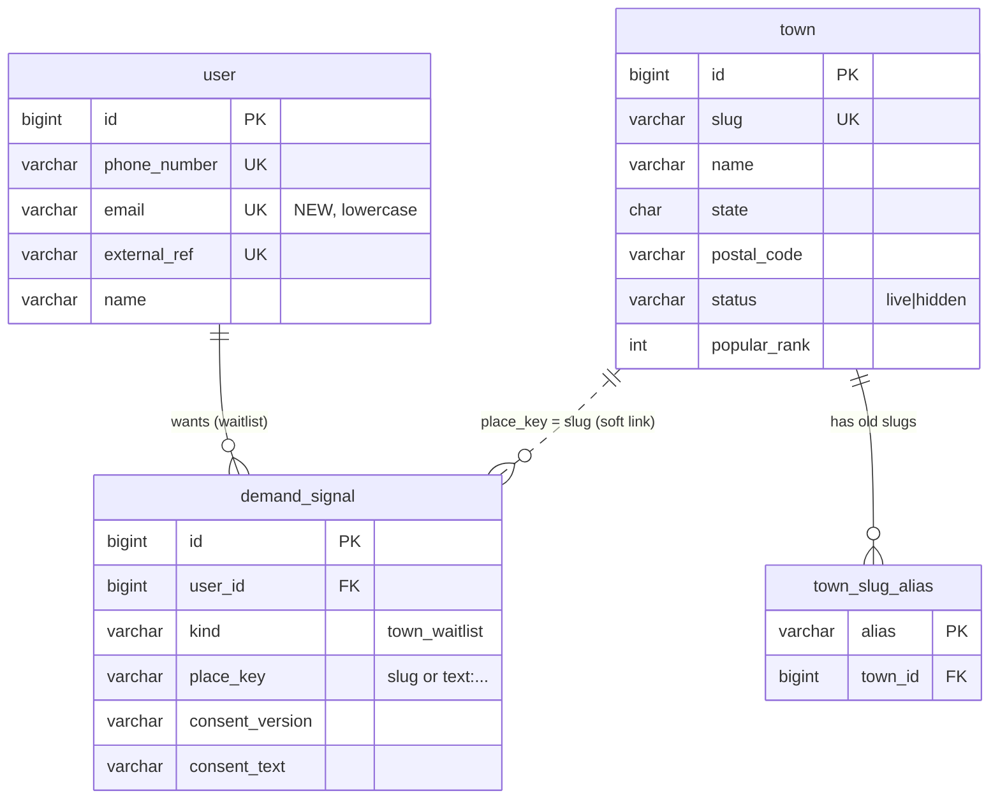
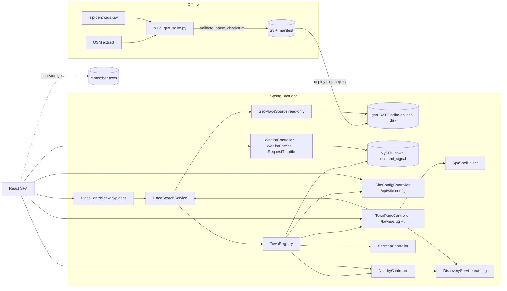
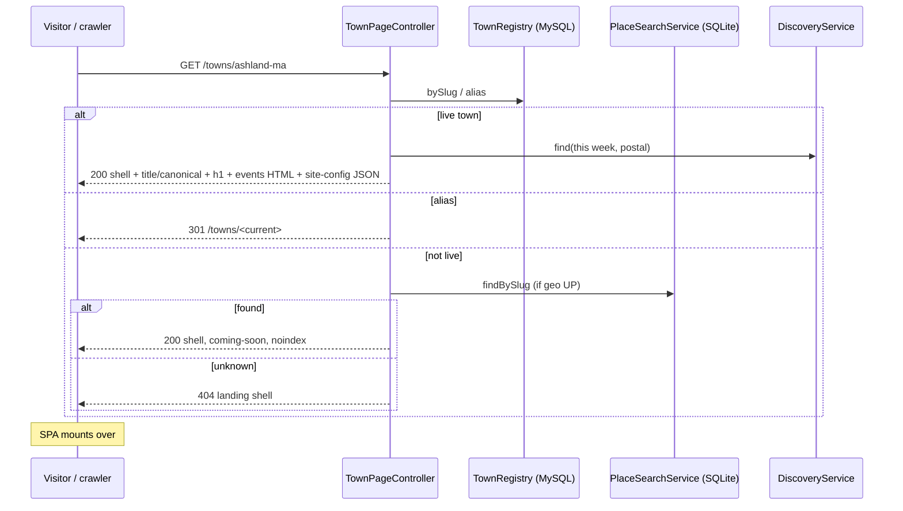
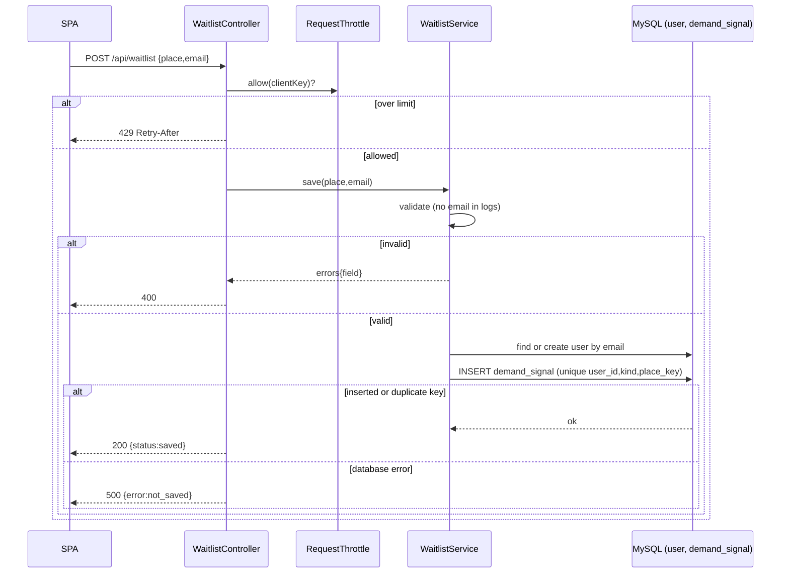

# Arangly — Town Entry & Coverage (P2.1) — SDD

> *How* P2.1 is built. It realizes `docs/p2.1-town-entry/trd.md` (REQ-P2.1-01..19). P2.1 does not
> change how events are queried or displayed once a town is chosen (P2). It changes how a visitor
> *gets to* a town (search, near me, town URLs, remember town), makes coverage **data** instead of a
> hard-coded list, captures demand for uncovered towns, and makes town pages discoverable.
> No application code is written until this design is approved.
>
> Chain: `UF → AC (PRD) → REQ (TRD) → T# (§7 here) → TC (TTP)`.

## 0. Phase 0 — technical unknowns, resolved or raised

| # | Unknown | Resolution | Alternatives considered |
|---|---------|------------|-------------------------|
| U1 | Where does "live town" status live, and where does the searchable place data live? | **Two stores, by nature of the data.** Coverage (which towns are live) is operational, editable data → **MySQL** (`town` table). The set of all resolvable places is a large read-only dataset built offline → **SQLite file** (§3). | One store: the live flag inside the SQLite file (rejected: the file is a rebuilt, read-only artifact; flipping a town live must not need a rebuild). Everything in MySQL (rejected: the full place set and its full-text index are build output, and MySQL full-text prefix search is a poorer fit; also keeps a large imported dataset in the operational DB). |
| U2 | Where does a demand signal live? (PRD OQ-P2.1-1) | **PROPOSED (v0.2): the email is identity on `user`; the wish is a row in `demand_signal` that points at the user** (DD-P2.1-1). One typed, unique `user.email` column; no email copy in the signal table. | Email inside `demand_signal` only (rejected in v0.2: copies identity into a second table and cannot be joined to a person later). Email in `user_metadata` (rejected: key/value rows cannot enforce one-user-per-email, so concurrent requests could create duplicates). A table per signal type (rejected: generality). |
| U3 | How do crawlers see town content? (PRD OQ-P2.1-4) | **PROPOSED: server-injected page shell** (DD-P2.1-3): the Spring app serves the SPA's `index.html` with town-specific head tags and plain HTML content injected; the SPA then takes over. No new runtime. | Prerender at release with a headless browser (rejected as default: pages go stale daily because events change; adds a build-time browser). Full server-side React rendering (rejected: new Node runtime on the server). |
| U4 | Does the Java SQLite driver include FTS5 and R-tree? | **UNVERIFIED — resolved by the first task (T1 spike) before T3 starts.** Fallback if FTS5 is missing: a prefix-indexed ordinary table (`name_search LIKE 'ash%'` on an indexed column) which is enough for type-ahead at this scale. | Choosing a different driver (only if both options fail). |
| U5 | How are state and ZIPs attached to OSM places in the build? | **PROPOSED (DD-P2.1-4):** use the existing ZIP-centroid data as the base: each ZIP gets its state from its ZIP prefix; OSM place nodes (towns, villages, neighborhoods) are attached to the nearest ZIP centroid(s) within a fixed distance. Validated against the 28 seeded towns in the build. | Point-in-polygon against OSM state/town boundary relations (more exact; heavier build; kept as the escalation if validation fails). |
| U6 | Does adding a second JDBC source break the existing MySQL data source? | **Known Spring Boot behavior, designed around:** Boot's data source auto-configuration backs off if any `DataSource` bean exists. The SQLite connection is therefore **not registered as a `DataSource` bean**; it is held inside `GeoPlaceSource` (§3.3). | Registering it as a named `DataSource` with `@Primary` on MySQL (works, but easy to break; rejected). |
| U7 | What is the real client address behind the Cloudflare tunnel, for throttling? | **PARTLY UNVERIFIED.** `server.forward-headers-strategy=framework` makes Spring honor `X-Forwarded-Proto/Host`; it does **not** replace the remote address from `X-Forwarded-For`. Cloudflare sets `CF-Connecting-IP`. Design: throttle key = `CF-Connecting-IP` when `arang.site.trust-cf-header=true`, else the remote address. The header is trustworthy only if the tunnel is the sole way to reach the app (true for the planned AWS/tunnel setup; to be confirmed at deploy). | Trusting `X-Forwarded-For` (spoofable by the client). |
| U8 | Will Vite keep `<title>` and `<div id="root">` stable for string injection? | **Yes** — both are literal in `web/index.html`, and Vite's build leaves them in place (the current built `static/index.html` shows exactly `<title>…</title>` and `<div id="root"></div>`). The injector matches those two literal strings. | HTML comment markers (rejected: build tools may strip comments). |
| U9 | What does "the credit the license requires" say? | **UNVERIFIED — blocks launch, not design.** OSM data is ODbL (credit "© OpenStreetMap contributors"). The ZIP data's origin is stated in code as GeoNames; its license has **not** been verified (the code comment calls it public-domain, GeoNames states CC BY — to be checked). The credit text is read from the data file's `meta` table, so fixing the wording is a data change. | Hard-coding the wording (rejected). |

## 1. Data model

### 1.1 What is added to MySQL (Flyway `V3__p2_1_town_entry.sql`)
One column on `user` and three tables. All follow the generality steering: shared vocabulary as lookup rows, and "kind is data".

```sql
-- Coverage registry: which towns Arangly serves. A town going live is an UPDATE, not a release.
CREATE TABLE town (
  id            BIGINT PRIMARY KEY AUTO_INCREMENT,
  slug          VARCHAR(80)  NOT NULL UNIQUE,          -- 'ashland-ma'  (URL: /towns/ashland-ma)
  name          VARCHAR(80)  NOT NULL,                 -- 'Ashland'
  state         CHAR(2)      NOT NULL,                 -- 'MA'
  postal_code   VARCHAR(16)  NOT NULL,                 -- primary ZIP; what /api/discovery?location= uses
  latitude      DECIMAL(9,6) NOT NULL,
  longitude     DECIMAL(9,6) NOT NULL,
  map_zoom      TINYINT      NOT NULL DEFAULT 14,
  status        VARCHAR(16)  NOT NULL DEFAULT 'live',  -- 'live' | 'hidden'   (data, not an enum type)
  popular_rank  INT          NULL,                     -- non-null => shown as a "Popular" chip, ascending
  created_at    TIMESTAMP DEFAULT CURRENT_TIMESTAMP,
  updated_at    TIMESTAMP DEFAULT CURRENT_TIMESTAMP ON UPDATE CURRENT_TIMESTAMP,
  KEY idx_town_status (status)
);

-- Old slugs keep working after a rename or merge: /towns/<alias> -> 301 -> /towns/<slug>.   (REQ-P2.1-05)
CREATE TABLE town_slug_alias (
  alias    VARCHAR(80) PRIMARY KEY,
  town_id  BIGINT NOT NULL,
  FOREIGN KEY (town_id) REFERENCES town(id) ON DELETE CASCADE
);

-- Identity: an email is a contact identity, parallel to phone_number (stored lowercase, unique).
-- A waitlist visitor becomes a lightweight user row, exactly like a cookie visitor does in P2.
ALTER TABLE `user` ADD COLUMN email VARCHAR(254) NULL UNIQUE;

-- A recorded wish, pointing at the person. 'kind' is data: a future signal type is a new value, not a new table.
CREATE TABLE demand_signal (
  id               BIGINT PRIMARY KEY AUTO_INCREMENT,
  user_id          BIGINT       NOT NULL,
  kind             VARCHAR(32)  NOT NULL DEFAULT 'town_waitlist',
  place_key        VARCHAR(120) NOT NULL,   -- town slug when resolved, else 'text:' + normalized typed text
  place_label      VARCHAR(80)  NOT NULL,   -- as shown or typed, for humans
  consent_version  VARCHAR(16)  NOT NULL,
  consent_text     VARCHAR(500) NOT NULL,   -- the exact wording the visitor was shown
  created_at       TIMESTAMP DEFAULT CURRENT_TIMESTAMP,
  UNIQUE KEY uq_demand (user_id, kind, place_key),   -- idempotent repeats (REQ-P2.1-11)
  KEY idx_demand_place (kind, place_key),             -- who wants this town (for the future "now live" notice)
  FOREIGN KEY (user_id) REFERENCES `user`(id) ON DELETE CASCADE
);
```
- **Seed:** the migration inserts the 28 current towns (slug, name, state, ZIP, point, zoom) from the SPA's
  hard-coded list, all `status='live'`, with `popular_rank` 1–6 for Ashland, Framingham, Natick, Boston,
  Cambridge, Newton (matching the landing chips). This is the only place the list is copied from code; after it,
  the SPA reads towns from the server.
- **One additive change to `user` (the `email` column).** No change to `event` or any other P1/P2 table. `town.postal_code` feeds the existing
  `/api/discovery?location=<postal>`; discovery code is untouched.
- **Removal requests (OQ-P2.1-3 default):** an operator deletes the `user` row found by `email`; the cascade
  removes that person's signals. No UI in P2.1. *Caution:* the cascade also removes interests if the same `user`
  row has any. P2.1 never links an email user to a cookie user (DD-P2.1-1), so a waitlist-only user has none.
- **Existing code is safe with email-only users:** web visitors already have `user` rows with no phone number
  (`external_ref` only), and the only phone lookups are `findByPhoneNumber`, which ignore null phones.
  `UserDao` gains `findByEmail` and an `email` field on insert.

### 1.2 ER diagram

`demand_signal.place_key` is intentionally **not** a foreign key to `town`: it also holds towns Arangly has not
added (free text, or places found only in the SQLite file). When a town is later added, its signals are found by
`place_key = town.slug`. A full-schema diagram is in `docs/p2.1-town-entry/schema-erd.html`.

### 1.3 The SQLite place file (read-only artifact, not part of MySQL)
Built offline, never written by the app (§3). Illustrative schema (the build script owns the final form):
`place(id, osm_id, name, search_name, type, state, slug, latitude, longitude)`,
`place_zip(place_id, zip)`, `zip(zip, state, latitude, longitude)`, a prefix-search index on `search_name`
(FTS5 if U4 passes), an R-tree on points (only needed if a nearest-point query is added; P2.1's near-me runs
over the ≈28 live towns, so it is **not** required for P2.1), and `meta(key, value)` with `schema_version`,
`osm_data_date`, `build_date`, `source_checksum`, `license_text`, `credit_text`.

## 2. Behavior → implementation (per REQ)

| REQ | Realized by |
|-----|-------------|
| 01 search by name/ZIP, select live → open | `GET /api/places?q=` → `PlaceSearchService` (§3.4) ; SPA `Landing` type-ahead (T10). `q` > 80 chars → 400 |
| 02 every in-region place resolves; same-name different states both | Build-time validation (T1) + the search returns all rows with their state; the result label always shows `Name, ST` |
| 03 near me → nearest live within limit; coordinates not persisted; invalid rejected | **Client-side** (DD-P2.1-6): the SPA reads the live towns and `nearMeMiles` from `site-config`, computes the nearest by distance in the browser, validates the numbers. Coordinates never leave the device |
| 04 location denied/unavailable | SPA `Landing` message; search stays usable (T10) |
| 05 town URL; change town → landing; old slug redirect; query does not change canonical | `TownPageController` `GET /towns/{slug}` (T5); alias → 301; SPA routing (T9); canonical built without query string |
| 06 unknown/malformed → landing; resolvable not-live → coming soon | `TownPageController` decision table (§4.5); SPA shows the matching state (T9, T10) |
| 07 live status from data | `town.status` read by `TownRegistry` (T5); used by shell, site-config, nearby, sitemap |
| 08 nothing-on state with nearby towns + submit link | `GET /api/towns/{slug}/nearby` (T8); SPA `Discovery` empty state (T11); link to existing `/submit` |
| 09 coming soon vs not found | SPA decision using `/api/places` result: resolved & not live → coming soon; no match for ≥3 chars → "place not found" (T10) |
| 10 durable demand signal; confirm only after stored | `WaitlistService` finds or creates the `user` by email, inserts the `demand_signal`, commits, then returns 200 (T7); SPA shows "saved" only on 200 |
| 11 validation; failure keeps value; repeat is idempotent | `WaitlistService` validation; `UNIQUE (user_id, kind, place_key)` and `UNIQUE (email)`; a duplicate-key outcome is treated as success (T7) |
| 12 throttle; 429; no reveal of existing emails | `RequestThrottle` per client key (DD-P2.1-7); identical `200 {"status":"saved"}` for new and repeat (T7) |
| 13 sitemap | `SitemapController` `GET /sitemap.xml` from `town` where `status='live'` + landing; base URL from `arang.site.public-url` (T6) |
| 14 robots | `SitemapController` `GET /robots.txt` (T6) |
| 15 no email in logs/URLs/responses | `WaitlistService` never logs the address; errors name fields only; no endpoint returns stored emails; checked by a log-capture test (T7, T12) |
| 16 remember town (browser only) | SPA `localStorage` key; read at `/` (T9). Nothing sent to the server |
| 17 page identity + brand | `SpaShell.inject` writes unique `<title>`, canonical, description, and visible town content (T5); brand strings changed in the SPA (T11) |
| 18 resilience when place data missing | `GeoPlaceSource.status()`; `/api/places` → 503; `site-config.geo="UNAVAILABLE"`; SPA falls back to the embedded live towns; `/health` shows it (T3, T4, T10) |
| 19 credit; no third-party calls while typing; data date in health | `credit_text` from file `meta` via `site-config`, shown in the landing footer (T10); search only calls our own `/api/places`; `/health.geo.dataDate` (T3) |

## 3. Place data: the SQLite file and how it is built, deployed, and read
This section is the design form of the PRD's non-binding hand-off notes.

### 3.1 Principle
Building the file is an **offline job**. The API server only **opens it read-only and reads**. No download,
conversion, table creation, or write ever happens in the API server.

### 3.2 Build (offline) — `scripts/geo/build_geo_sqlite.py` + README (T1)
1. Download the OSM extract (New England) and record URL, date, checksum.
2. With pyosmium (already installed on the dev machine; to be verified in T1) keep place nodes
   (`place=city|town|village|hamlet|suburb|neighbourhood|locality`). Exact tag list is confirmed in T1 against data.
3. Read `geo/zip-centroids.csv`; derive each ZIP's state from its prefix; attach each place to its nearest ZIP
   centroid(s) within a fixed distance (DD-P2.1-4). Build `search_name` (lowercase, accent-free) and the slug
   `<name>-<state>`; disambiguate a collision within one state by appending the first ZIP.
4. Write the SQLite file, then the `meta` table (`schema_version=1`, dates, checksum, license text, credit text).
5. **Validate; publish nothing on failure:** all 28 seeded towns resolve with the right state and ZIP; slugs unique;
   every point inside the region; no empty names; a prefix search for "ash" returns Ashland; the file opens
   read-only; row count above a floor.
6. Name `geo-YYYY-MM-DD.sqlite`, compute the checksum, mark read-only, upload to S3, and update a small
   `manifest.json` (current file name + checksum). Keep the last few versions for rollback.

### 3.3 Deploy
A deploy step (container start script or image build — **not** Java code) reads `manifest.json`, copies the named
file to local disk, verifies the checksum, and sets `ARANG_GEO_FILE`. Local development runs the same script into a
git-ignored `data/geo/` and points `ARANG_GEO_FILE` at it. Rollback: change the manifest to the previous file and
restart.

### 3.4 Read (in the app)
- **`GeoPlaceSource`** — on startup: if `arang.geo.file` is set and exists, open it read-only
  (`jdbc:sqlite:file:<path>?mode=ro`), read `meta`, and check `schema_version == 1`. Result: `UP`, with
  `dataDate`, `schemaVersion`, `creditText`; or `UNAVAILABLE` with a reason. **It never throws at startup.**
  It holds its own connection(s); it is **not** a `DataSource` bean (U6).
- **`PlaceSearchService`** — `search(q)`: normalizes `q`; if it is 1–5 digits, searches ZIP prefix; otherwise builds
  a safe prefix query (tokens limited to `[a-z0-9]`, each quoted, last token gets `*` — user text is never
  concatenated into the query syntax); returns at most 8 rows ranked: live towns first, then place type
  (town > village > neighborhood), then name; marks each row `live` by joining the set of live slugs from `TownRegistry`.
  `findBySlug(slug)` returns a place or empty (used for the coming-soon decision).
- **Writes:** none, ever. A computed point for an event goes to MySQL (P2.2).

## 4. Contracts

### 4.1 `GET /api/site-config`
Also embedded in every HTML page as `<script id="site-config" type="application/json">` (so the landing works with
no extra request and "built into the page" holds when place data is down). The SPA reads the embedded copy, and
falls back to fetching this endpoint (Vite dev server has no shell).
```json
{
  "towns": [ { "slug":"ashland-ma","name":"Ashland","state":"MA","postal":"01721",
               "lat":42.2539,"lng":-71.4583,"zoom":14,"popularRank":1 } ],
  "nearMeMiles": 100,
  "consent": { "version":"v1", "text":"We'll only email you about Arangly in <town>." },
  "credit": "© OpenStreetMap contributors",
  "geo": "UP",
  "publicUrl": "https://arangly.com"
}
```
Only `status='live'` towns appear. `consent.text` is a template with `<town>`; the stored `consent_text` is the
rendered string.

### 4.2 `GET /api/places?q=<text>`
- `200` `{ "results":[ { "slug":"ashland-ma","name":"Ashland","state":"MA","zip":"01721","live":true } ] }`
  (≤ 8; empty list when nothing matches)
- `400` `{ "error":"q_invalid" }` — empty after trim, or longer than 80 characters
- `503` `{ "error":"geo_unavailable" }` — place data missing or wrong version (REQ-P2.1-18)

### 4.3 `POST /api/waitlist`
Request: `{ "place":"worcester-ma" | "Worcester", "email":"a@b.co" }`
- `200` `{ "status":"saved" }` — returned for a new row **and** for a repeat (identical body)
- `400` `{ "errors": { "email":"invalid" } }` or `{ "errors": { "place":"invalid" } }` — never echoes the address
- `429` `{ "retryAfterSeconds": 30 }` with `Retry-After`
- `500` `{ "error":"not_saved" }` — nothing was stored; the SPA shows an error and keeps the value
Server rules: trim; email ≤ 254, exactly one `@`, non-empty local and domain, no whitespace/control characters;
the stored `user.email` is the lowercased address; `place` ≤ 80 chars; if `place` equals a `town.slug` or a place found by slug in the SQLite
file, `place_key` = that slug, else `'text:' + lowercased collapsed text`. Works when place data is down (free text). Order of work: find user by email (create if absent; a concurrent
duplicate-key on `email` is caught and the existing row is re-read), then insert the signal (a duplicate-key on
`(user_id, kind, place_key)` is caught and treated as success). The cookie identity (`arang_uid`) is **not** read or
linked.

### 4.4 `GET /api/towns/{slug}/nearby?from=&to=`
Returns up to 3 *other* live towns within `nearMeMiles` that have ≥ 1 published event in the window, nearest first:
`{ "towns":[ { "slug","name","state","distanceMiles","eventCount" } ] }`. `404` for an unknown or hidden slug.
Window defaults to this week, as `/api/discovery`.

### 4.5 `GET /towns/{slug}` (HTML)
| Case | Status | Body |
|------|--------|------|
| slug is a live town | 200 | SPA shell, title/canonical/description for the town, server-rendered h1 and this week's events as plain HTML |
| slug is an alias of a live town | 301 | `Location: /towns/<current slug>` |
| slug resolves in the place file but is not live | 200 | SPA shell for the coming-soon state, `<meta name="robots" content="noindex">` |
| unknown or malformed slug | **404** | SPA shell for the **landing** (visitors see the landing; crawlers get 404). Reconciles AC-P2.1-06 with correct crawler behavior (DD-P2.1-5) |
| any | — | canonical URL never includes the query string |
`GET /` returns the landing shell (title, canonical, description, and plain links to every live town).

### 4.6 `GET /sitemap.xml`, `GET /robots.txt`
Sitemap: the landing URL plus `<publicUrl>/towns/<slug>` for each live town. No `lastmod` (there is no honest per-page
date). Robots: `Disallow` for `/add`, `/submit`, `/console`, `/review/`, `/api/`, `/webhook/`, `/media/`, and
`Sitemap: <publicUrl>/sitemap.xml`. `publicUrl` is `arang.site.public-url` (env `ARANG_SITE_PUBLIC_URL`, default
`http://localhost:8080`; production `https://arangly.com`). The static templates in `deploy/cloudflare/` are removed
by T6.

### 4.7 `GET /health` (additive)
Adds `"geo": { "status":"UP"|"UNAVAILABLE", "dataDate":"2026-11-01", "schemaVersion":1, "reason":"…" }`. The top-level
`status` stays `UP` (event serving works without place data); existing smoke checks are unchanged.

## 5. Diagrams

### 5.1 Components


### 5.2 Town page request (REQ-P2.1-05, 06, 07, 17)


### 5.3 Waitlist submit (REQ-P2.1-10, 11, 12, 15)


## 6. Module / package structure
Backend (`com.arang.intake`):
- `geo/GeoPlaceSource.java`, `geo/GeoProperties.java`, `geo/PlaceSearchService.java`, `geo/Place.java`
- `town/TownRegistry.java` (JdbcTemplate DAO + cache-free reads), `town/Town.java`
- `controller/PlaceController.java`, `controller/SiteConfigController.java`, `controller/TownPageController.java`,
  `controller/NearbyController.java`, `controller/SitemapController.java`, `controller/WaitlistController.java`
- `web/SpaShell.java` (reads `static/index.html` once, injects head + content + site-config JSON)
- `waitlist/WaitlistService.java`, `waitlist/RequestThrottle.java`, `dao/DemandSignalDao.java`, and `UserDao` / `model/User` extended with `email` (`findByEmail`, insert with email)
- `controller/HealthController.java` (extend), `db/migration/V3__p2_1_town_entry.sql`
- `build.gradle`: add `runtimeOnly 'org.xerial:sqlite-jdbc:<pinned version>'` (version chosen in T1 after U4)
Front end (`web/src`): `router.js` (path parsing + history), `siteConfig.js`, changes to `App.jsx`, `Landing.jsx`,
`Discovery.jsx`, `discoveryApi.js`, `index.css`; `web/index.html` unchanged.
Scripts: `scripts/geo/build_geo_sqlite.py`, `scripts/geo/README.md`, deploy step note in `scripts/`.
Config keys: `arang.geo.file`, `arang.site.public-url`, `arang.site.near-me-miles` (100),
`arang.site.trust-cf-header`, `arang.waitlist.rate-per-minute` (5), `arang.waitlist.consent-version/text`.

## 7. Checks (feed the TTP)

| REQ | Check |
|-----|-------|
| 01 | `GET /api/places?q=ash` includes Ashland; `?q=017` returns ZIP-prefix matches; `q` of 81 chars → 400 |
| 02 | Build validation: all 28 seeded towns resolve; a sample name with two states returns both (e.g. a test fixture) |
| 03 | Browser test: with a mocked position in Framingham → Framingham opens; with a mocked far-away position → message, no navigation; network log shows no request containing the coordinates |
| 04 | Browser test: permission denied → message shown, search input usable, no error page |
| 05 | Fresh browser: `/towns/ashland-ma` shows Ashland events with no landing step; "change town" → landing; alias request → 301; `?window=…` leaves canonical unchanged |
| 06 | `/towns/zzz-xx` → 404 + landing visible; `/towns/<resolvable not-live>` → coming-soon + noindex |
| 07 | Update `town.status` to `hidden` for a test town → it disappears from site-config, search `live` flag, sitemap, and its page becomes coming-soon |
| 08 | A live town with no events and a neighbor with events → nearby list shows the neighbor; a link to `/submit` is present; no coming-soon text |
| 09 | UI test: "Worcester" (resolvable, not live) → coming soon; "xqzv" → "place not found" |
| 10 | Post a valid email → a `user` row with that lowercase email and a `demand_signal` row (place_key, consent text, time) exist; UI shows "saved" only after the 200 |
| 11 | Invalid email → 400 + value kept; kill the database → 500 + no saved state; same email twice for one place → one user row, one signal row, second returns the same 200; same email for a second place → one user row, two signal rows; two parallel requests with a new email → one user row |
| 12 | Exceed 5/min from one client key → 429 and UI message; bodies for new vs repeat are byte-identical |
| 13 | Fetch `/sitemap.xml`: contains the landing + exactly the live towns; contains none of the excluded prefixes; flipping a town changes the next fetch |
| 14 | Fetch `/robots.txt`: disallow lines + `Sitemap:` line |
| 15 | Capture application log output at INFO while posting emails: the address never appears; no endpoint returns a stored email; deleting the user removes their signals (cascade) |
| 16 | Choose a town, reload `/` → opens that town; clear site data → landing; network log shows nothing about the choice |
| 17 | Fetch town page with scripts disabled: title, canonical, description, h1 with the town, and events text present; grep rendered screens for the name "Arang" without "ly" → none |
| 18 | Start the app with `ARANG_GEO_FILE` unset and with a wrong-version file: app starts, other pages work, `/api/places` → 503, landing shows embedded live towns, `/health.geo.status` = UNAVAILABLE |
| 19 | Landing footer shows the credit; typing in search produces requests only to our own origin; `/health.geo.dataDate` equals the file's `meta` date |

## 8. Dependency-ordered tasks (D5)
> Each task = 1 concern / ≤ 3 files / 1 test run. 12 tasks (at the cap).
> **First runnable slice = T2 → T5 → T6 → T9:** coverage as data, town URLs with crawlable pages, sitemap/robots, and
> routing + remember-town in the SPA. It needs **no** place file. The search slice (T1, T3, T4, T10) and the waitlist
> slice (T7) can then proceed in parallel.

- **T1 — Place-file build script + spike.** `scripts/geo/build_geo_sqlite.py`, `README.md`, and the validation checks;
  resolves U4 (driver features), U5 (state/ZIP linking), file size, and OSM tag list; verifies pyosmium. Output: a
  validated `geo-*.sqlite`. *(REQ-02, 18, 19; U4/U5/U9)*
- **T2 — Migration V3 + seed.** `V3__p2_1_town_entry.sql` (`user.email` column, three tables, 28 seeded towns) and a
  repository test that applies it on H2 and checks the seed and the existing user tests still pass. *(REQ-07, 10, 11)*
- **T3 — Read-only reader + health.** `GeoPlaceSource`, `GeoProperties`, `HealthController` extension; add the driver
  dependency (version from T1). Tests: missing file, wrong version, good file. *(REQ-18, 19)*
- **T4 — Places search API.** `PlaceSearchService` + `PlaceController`: safe prefix query, ZIP prefix, ranking, `live`
  flag, 400/503 behavior. *(REQ-01, 02, 09, 18)*
- **T5 — Town registry, site-config, and page shell.** `TownRegistry`, `SiteConfigController`, `SpaShell`,
  `TownPageController` (`/` and `/towns/{slug}`: 200 / 301 / noindex / 404 cases), WebConfig adjustments. *(REQ-05, 06, 07, 17)*
- **T6 — Sitemap and robots.** `SitemapController`; remove `deploy/cloudflare/*` templates; public-url config. *(REQ-13, 14)*
- **T7 — Waitlist.** `WaitlistController`, `WaitlistService`, `RequestThrottle`, `DemandSignalDao`, plus `UserDao` /
  `User` email support; validation, find-or-create by email (race-safe), idempotency, 429, no-email-in-logs test.
  *(REQ-10, 11, 12, 15)* — touches 5+ files; the `UserDao`/`User` change is small and mechanical. If the reviewer
  objects, split it into T7a (user email support) and T7b (waitlist), making 13 tasks.
- **T8 — Nearby towns API.** `NearbyController` using `TownRegistry` + `DiscoveryService`. *(REQ-08)*
- **T9 — SPA routing, town data from the server, remember town.** `router.js`, `siteConfig.js`, `App.jsx`; replace the
  hard-coded `locations` list with `site-config` towns; `history` navigation; `localStorage`. *(REQ-05, 06, 16)*
- **T10 — SPA landing: search, near me, coming soon, not found, waitlist form, credit.** `Landing.jsx`,
  `discoveryApi.js`, `index.css`. *(REQ-01, 03, 04, 09, 10, 11, 12, 18, 19)*
- **T11 — SPA nothing-on state and brand.** `Discovery.jsx` empty state (nearby + submit link), brand strings
  "Arangly" on the four screens, page-title handling. *(REQ-08, 17)*
- **T12 — E2E, deploy step, and docs.** Playwright tests for the TTP flows, the geo-file deploy step note
  (`scripts/`), release-script update to copy the whole build output and the geo manifest step, STATUS.md.
  *(REQ-15 log test, 19 network test; all)*

**REQ ↔ task coverage:** 01→T4,T10 · 02→T1,T4 · 03→T10 · 04→T10 · 05→T5,T9 · 06→T5,T9,T10 · 07→T2,T5 · 08→T8,T11 ·
09→T4,T10 · 10→T7,T10 · 11→T7,T10 · 12→T7,T10 · 13→T6 · 14→T6 · 15→T7,T12 · 16→T9 · 17→T5,T11 · 18→T3,T4,T10 ·
19→T3,T10,T12. Every REQ has a task; every task has a REQ (T1's U-items support REQ-02/18/19).

## 9. Design decisions (PROPOSED — driver to confirm)
- **DD-P2.1-1 — Demand signal storage (OQ-P2.1-1). CONFIRMED by the driver (2026-11-01).** *Design (v0.2, revised after the driver's challenge):* the
  email is **identity on `user`** (a new nullable unique `email` column, lowercase), and the wish is a row in
  **`demand_signal`** that references the user and carries `kind`, `place_key`, and the consent record. *Why:* an email
  is contact identity like `phone_number`; keeping it only inside the signal would duplicate identity and make a later
  join (interests, sign-in) a string match. A typed unique column is needed because `user_metadata` cannot enforce
  one-user-per-email. `kind` keeps signals general. *v0.1 had put the email inside `demand_signal`; that was rejected
  because it copied identity and because the earlier reasons ("no email column", "a visitor is not a user") were weak
  — columns can be added and P2 already creates visitor `user` rows.* *Rule kept:* P2.1 does **not** link the email
  user to the cookie identity (the visitor consented only to emails about one town); linking waits for real sign-in.
  *Alternatives rejected:* email only in `demand_signal`; email in `user_metadata`; a table per signal type.
  **Confirmed: `user.email` column + `demand_signal` table (touches the long-lived schema; approved).**
- **DD-P2.1-2 — Coverage lives in MySQL (`town`), not in code or the place file.** *Why:* PRD requires live status that
  changes without a release (REQ-07). *Alternative rejected:* a config file in the repo (needs a release to change).
- **DD-P2.1-3 — Crawlable pages by server-injected shell (OQ-P2.1-4). CONFIRMED by the driver (2026-11-01).** *Chosen over prerender at release.* *Why:*
  events change daily, so a release-time snapshot goes stale; the shell reads current data at request time and adds no
  new runtime. *Cost:* one string-injection class; the SPA still renders on top. *Rejected:* headless prerender;
  Node server rendering.
- **DD-P2.1-4 — Linking OSM places to ZIP and state in the build.** *Proposed:* nearest-ZIP-centroid + state from ZIP
  prefix, validated on the 28 towns; escalate to boundary polygons only if validation fails. *Why:* simplest build
  that can be checked automatically.
- **DD-P2.1-5 — Unknown town URL returns HTTP 404 with the landing page body.** *Why:* AC-P2.1-06 says show the
  landing; crawlers need a real 404 to drop bad URLs. Both hold. *Rejected:* 200 for everything (creates duplicate-content
  junk pages); 302 redirect to `/` (hides the problem and loses the URL).
- **DD-P2.1-6 — Near me runs in the browser.** *Why:* coordinates never leave the device (privacy; REQ-03 "not
  persisted" is true by construction); the live towns are already in the page. *Rejected:* a server endpoint (sends
  precise location to the server for no gain at 28 towns). *Revisit:* if live towns grow to thousands.
- **DD-P2.1-7 — Throttle in application memory, per instance.** *Why:* adequate before P4 hardening; no Redis to run.
  *Limit:* several instances each allow 5/min. *Revisit:* in P4. The client key uses `CF-Connecting-IP` only when
  explicitly trusted (U7).
- **DD-P2.1-8 — Site base URL is its own setting (`arang.site.public-url`).** *Why:* the existing public base URL is the
  WhatsApp review-link base (a tunnel address) and may differ from the public site. *Rejected:* reusing it.
- **DD-P2.1-9 — SQLite handled outside the DataSource mechanism.** *Why:* U6.
- **DD-P2.1-10 — No router library in the SPA.** Path parsing + `history.pushState` is ~40 lines for two route shapes.
  *Revisit:* P2.2 adds event routes; a library may then earn its place.

## 10. Alternatives considered (kept lean)
Live public Nominatim for search (forbidden for type-ahead, 1 request/s cap); self-hosted Nominatim/Photon (more to
operate; escalation path if matching quality is too low); a managed geocoding service (cost + storage rules; revisit for
P2.2 addresses); storing places in MySQL (large imported dataset in the operational DB); Elasticsearch/OpenSearch for
search (far beyond a few thousand rows); a separate geo microservice (no scaling reason).

## 11. Post-design steering re-check
- **Generality:** coverage is rows (`town.status`), demand is rows with a `kind` that reference a user, places are build output. No new
  primary table per variation. ✔
- **Intake-as-data:** not touched — P2.1 adds no event source. ✔
- **Identity vs role:** a waitlist email is identity, so it lives on `user` (typed unique `email`, next to `phone_number`); the wish itself is a separate `demand_signal` row. No role-like data is added to `user`. ✔
- **Stack:** Java + Spring Boot, MySQL, Gradle; one new runtime dependency (SQLite driver, pinned in T1); the offline
  build script is Python and is not part of the server runtime. ✔ (the Python build tool is a development tool, not a
  stack change — flagged for your awareness).
- **Environments:** all work and tests on dev; prod only by explicit release. ✔

## 12. Open items that block approval or launch
1. ~~Driver decisions DD-P2.1-1 and DD-P2.1-3~~ — **confirmed 2026-11-01.** The other eight decisions (DD-P2.1-2, 4–10) are proposed defaults still to be confirmed or changed at sign-off.
2. U4/U5 resolved by the T1 spike (driver features, state/ZIP linking, file size, OSM coverage of the 28 towns).
3. U9: the license and required credit wording for the ZIP data (GeoNames) and OSM.
4. U7: confirm at deploy that the tunnel is the only ingress before trusting `CF-Connecting-IP`.
5. TRD is 19 REQs (4 over the guideline); the driver chose to keep one feature. This SDD has 12 tasks (at the cap).

## 13. Version history
- **v0.1 (2026-11-01) — DRAFT.** First design from TRD v0.4. Read the real code first (hard-coded SPA town list, no
  place/town/waitlist table, `user` has no email, WebConfig forwards only `/add`, forward-headers strategy is
  `framework`). Proposed three tables and an offline-built read-only SQLite place file; 12 tasks; 10 design
  decisions (all proposed). Nothing implemented.
- **v0.2 (2026-11-01) — DRAFT.** Driver challenged where the email lives. Revised DD-P2.1-1: the email is identity on
  `user` (new nullable unique `email` column) and `demand_signal` references the user (`UNIQUE (user_id, kind,
  place_key)`) instead of storing the email. Updated U2, §1.1 DDL, §1.2 ER, §2, §4.3 server rules, §5.3 sequence,
  §6, §7 checks, T2 and T7, and the steering re-check. Checked the code: email-only users are safe (cookie visitors
  already have no phone; only `findByPhoneNumber` reads phones). The cookie identity is deliberately not linked.
- **v0.3 (2026-11-01) — DRAFT.** Driver confirmed DD-P2.1-1 (email on `user`, wish in `demand_signal`) and DD-P2.1-3
  (server-injected page shell, not prerender). This also resolves PRD open questions OQ-P2.1-1 (storage) and
  OQ-P2.1-4 (crawlable content) in the design; the PRD text is unchanged and still lists OQ-P2.1-4 as open until the
  next PRD revision. The SDD as a whole is NOT approved: reviews have not run and eight decisions are unconfirmed.
