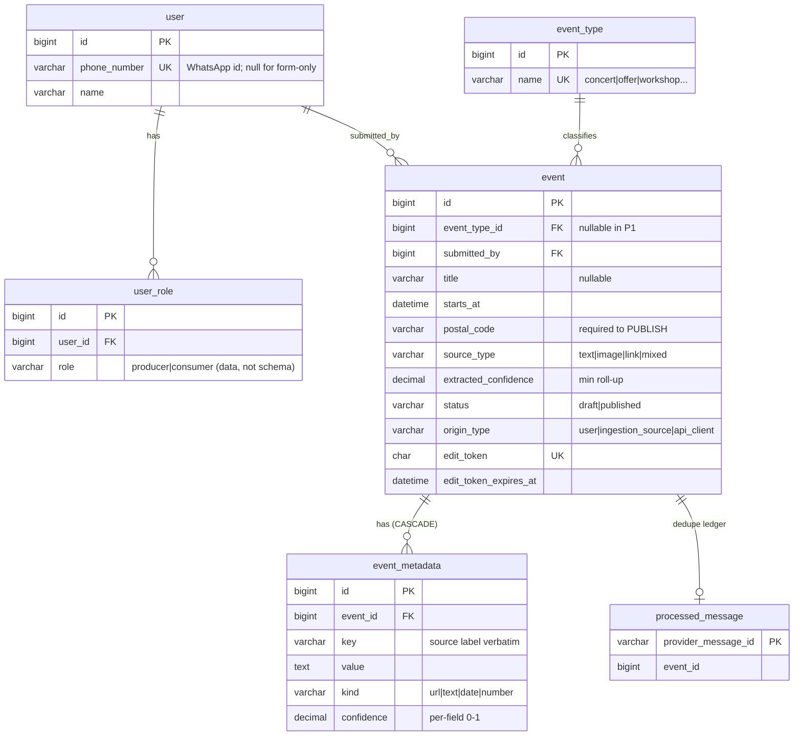
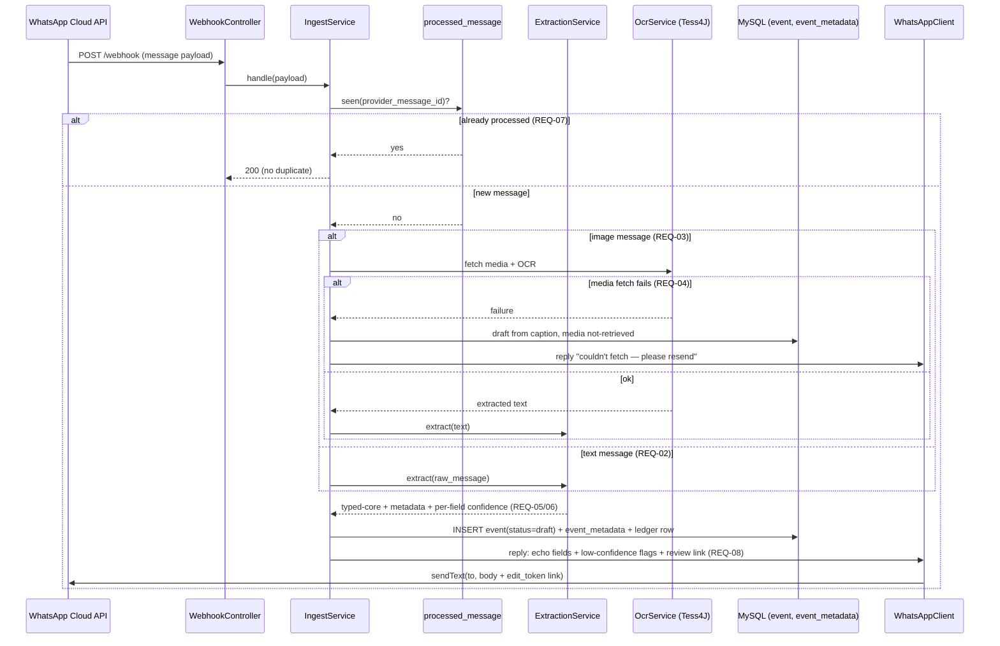
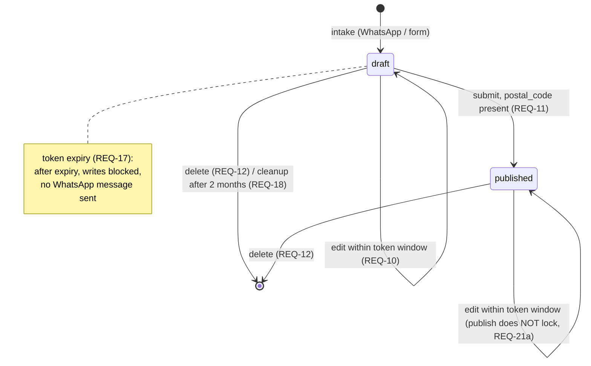
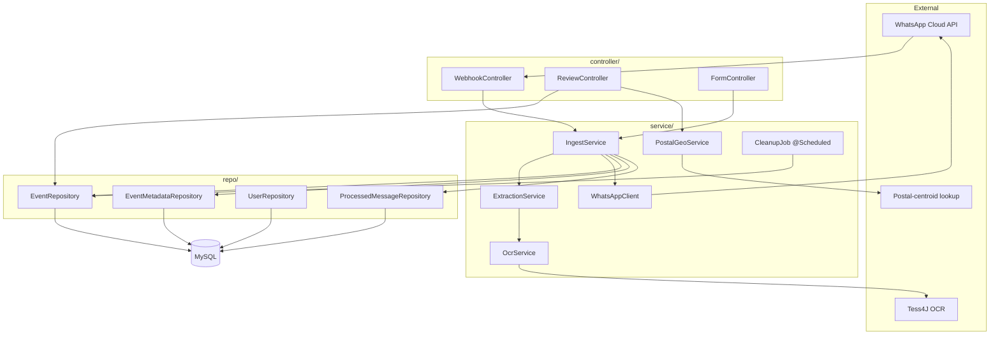

# P1 Producer-Intake — SDD Diagrams (reference copy)

> Illustrative Mermaid diagrams of the P1 design (ARANG-SDD-P1). **These now live canonically in
> the SDD itself** (`docs/producer-intake/sdd.md` §4); this file is a standalone reference copy.
> The SDD is the source of truth — if they diverge, the SDD wins.

## A. ER diagram — the P1 schema (§2)

## B. Sequence diagram — WhatsApp intake (REQ-01/02/03/04/05/06/07/08)

## C. State diagram — event lifecycle + token/cleanup (REQ-11/17/18)

## D. Component diagram — com.arang.intake (§4) + external edges

