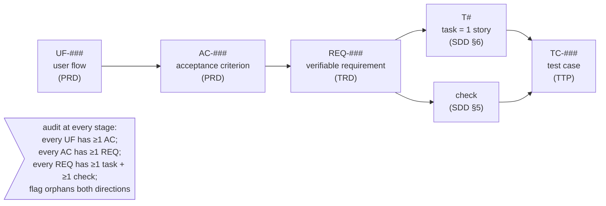
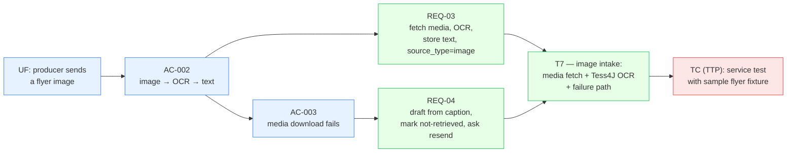

# Arang Spec-Driven AI Process — Diagrams

> How the authoring/reviewing skills, the artifacts, and the human decision points fit together,
> and how a single intent traces from PRD to test. Diagrams are Mermaid (render on GitHub / most
> editors). This doc is illustrative; the artifacts themselves (docs/*.md) remain the source of truth.

## 1. The spec-driven AI process (skills, artifacts, and human gates)

Each artifact is authored by a skill, self-gated, then put through a collaborative drill and an
independent gate before the **human** signs off. Humans decide; skills/agents execute.

```mermaid
flowchart TD
    idea([Feature idea]) --> prdA

    subgraph PRD_phase [PRD phase]
        prdA[/"skill: prd-author<br/>Fast vs Coaching mode"/] --> prdSelf{{self-validation loop ≤3×}}
        prdSelf --> prdDrill[/"skill: prd-section-reviewer<br/>collaborative drill"/]
        prdDrill --> prdGate[["agent: spec-reviewer<br/>independent cold-eyes gate"]]
    end
    prdGate --> prdSignoff{Human sign-off?}
    prdSignoff -- no, revise --> prdA
    prdSignoff -- yes --> trdA

    subgraph TRD_phase [TRD phase · docs/feature/trd.md]
        trdA[/"skill: trd-author<br/>REQ-### ⟵ AC, verifiable"/] --> trdSelf{{self-validation loop ≤3×}}
        trdSelf --> trdRev[/"skill: spec-section-reviewer"/]
    end
    trdRev --> sddA

    subgraph SDD_phase [SDD phase]
        sddA[/"skill: sdd-author<br/>Phase 0 resolve unknowns"/] --> sddDesign["Phase 1: schema · behavior→impl · contracts · diagrams · D5 tasks"]
        sddDesign --> sddSteer{{post-design steering re-check}}
        sddSteer --> sddSelf{{self-validation loop ≤3×}}
        sddSelf --> sddRev[/"skill: spec-section-reviewer"/]
        sddRev --> sddGate[["agent: spec-reviewer<br/>independent gate"]]
    end
    sddGate --> sddSignoff{Human sign-off?}
    sddSignoff -- no, revise --> sddA
    sddSignoff -- yes --> ttpA

    subgraph TTP_phase [TTP phase · lighter/optional]
        ttpA[/"skill: ttp-author<br/>TC-### ⟵ REQ/AC"/]
    end
    ttpA --> build

    subgraph Build_phase [Build phase]
        build["Implement task (1 story)"] --> cr[/"skill: code-review<br/>edge-cases + verification-gaps"/]
        cr --> verify{{build + run tests}}
        verify -- fail --> build
        verify -- pass --> next{More tasks?}
        next -- yes --> build
    end
    next -- no --> done([Feature done])

    classDef skill fill:#e6f2ff,stroke:#3b82f6;
    classDef agent fill:#fde6e6,stroke:#ef4444;
    classDef human fill:#fff4d6,stroke:#d9a406;
    class prdA,prdDrill,trdA,trdRev,sddA,sddRev,ttpA,cr skill;
    class prdGate,sddGate agent;
    class prdSignoff,sddSignoff human;
```

**Legend:** blue = authoring/reviewing **skill** (same assistant, our context) · red = independent
**agent** (isolated context, cold eyes) · yellow = **human** decision gate · `{{ }}` = a self-check
the skill runs on itself before hand-off.

## 2. Traceability chain (how one intent flows to a test)

Stable IDs carry an intent from PRD to proof. Cardinality: `AC→REQ` and `REQ→Task` are
many-to-many; **Task→Story is strictly 1:1** (per steering).

### Worked example from the P1 Producer-Intake docs (real IDs)

> One AC can fan out to several REQs; one task (T7) can satisfy several REQs (REQ-03 + REQ-04);
> and several REQs/checks can converge on one TC. The chain is auditable in both directions —
> an orphan at any stage (a UF with no AC, a REQ with no task) is a flagged gap.

## 3. What an SDD should picture (recommended diagram set per design doc)

For a feature's SDD, include whichever of these the design actually has (don't draw empty ones):

| Diagram | Captures | When to include |
|---|---|---|
| **ER diagram** (`erDiagram`) | tables + FK relationships from the §2 schema | any feature that touches the schema |
| **Sequence diagram** (`sequenceDiagram`) | multi-service request flows (who calls whom, in order) | any flow crossing ≥2 components |
| **State diagram** (`stateDiagram-v2`) | entity lifecycle + transitions (e.g. `draft→published`) | any feature with a status/lifecycle |
| **Component diagram** (`flowchart`) | package/module layout + external edges | features adding modules or external integrations |

See `arang-sdd-p1-diagrams.md` for these rendered against the actual P1 design.
